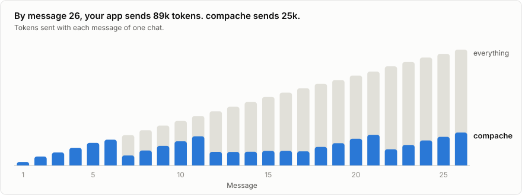
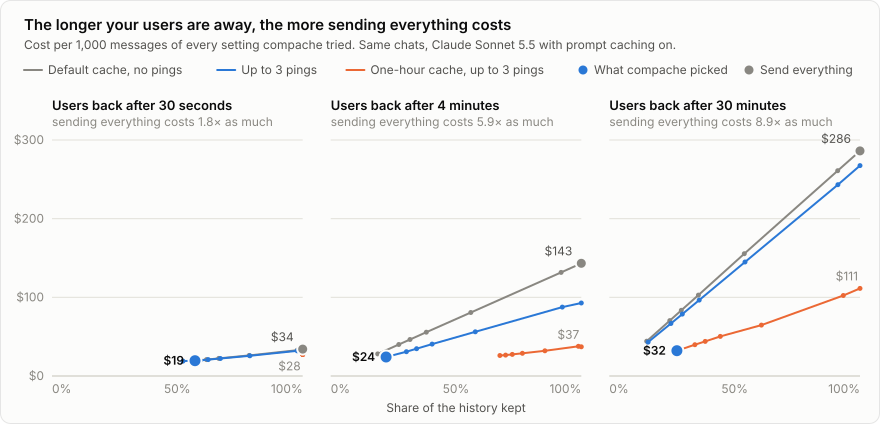

# compache

**Stop paying for your whole chat history on every message.**

[](https://github.com/BarendPotijk/compache/actions/workflows/tests.yml)   [](LICENCE.md)

compache sits between your chatbot and the model API. It learns from your own conversations which parts of the history still matter and when your users come back, then sends less and caches better. The rest of your application stays as it is.


[Get started](#get-started) · [Works with](#works-with) · [Results](#results) · [Cost calculator](https://barendpotijk.github.io/compache/) · [Docs](docs/README.md)

## Why long chats get expensive

Models have no memory, so your app sends the whole conversation with every message: each question, each answer, each document it ever retrieved. There are two ways to pay less, and **they work against each other**:

- **Prompt caching** makes repeated text cheap, until the user takes a break and the cache expires. On Claude that takes five minutes.
- **Trimming** (compaction) sends less text, but rewriting the history throws the cache away, and the model can lose something it needs.

compache is **compaction + cache**, decided together:



- **Trims at the right moment.** When the cache has expired, the history has to be paid for in full anyway. That is when compache trims it.
- **Keeps the cache warm.** While a user is away for a short break, a tiny request (a ping) keeps the cache alive, if that costs less than losing it.
- **Keeps the rest in reach.** Trimmed text leaves a short notice. When the model needs it, it can fetch it back before your app sees the reply.

## Get started

```sh
pip install git+https://github.com/BarendPotijk/compache
```

**1. Record.** One line around the client you already have. Your requests and replies do not change.

```python
import compache
from anthropic import Anthropic

client = compache.wrap(Anthropic(), record="compache-record", sample=0.1)
```

The record holds sizes, times and token usage, **never text**. For one message in ten, the model is asked afterwards which earlier parts its reply needed, which adds about 5% to the bill while you record. In our runs some 600 messages were enough.

**2. Fit.** compache prices every candidate setting on your own traffic and prints what you would save, before anything in your app changes.

```sh
compache fit compache-record --model claude-haiku-5-5
```

**3. Apply.** Same line, with the result.

```python
client = compache.wrap(Anthropic(), "policy.json")
```

That is all. There are no thresholds to tune.

<details>
<summary><b>Try it now</b>, on four sample chats in two seconds, without an API key</summary>

```sh
compache demo -o policy.json
```

```text
Fitted on 4 sample threads, 71 turns (71 labelled) for claude-sonnet-5-5.

Keep questions from the last 4 turns, answers from the last 9 turns and retrieved text from the last turn.
Send up to 1 keep-warm ping while a user is away.
82% of what the labelled turns need from earlier turns stays in view. The rest is fetched back, and that call is in the cost.
$16.10 per 1,000 turns against $50.25 keeping everything: 68% less.

Wrote policy.json
```

In a clone of this repository, `python examples/quickstart/apply.py` then plays one of those chats, the one in the figure above, message by message.
</details>

<details>
<summary><b>Already have chat logs?</b> Skip the recording</summary>

```sh
compache pull langfuse -o threads.jsonl.gz      # or: mlflow, otel. Your own chat log works as it is
compache fit threads.jsonl.gz --labels labels.jsonl --model claude-haiku-5-5
```

Labels say, for a sample of messages, which earlier parts were needed. A [coding-agent skill](skills/compache-label-dependencies/SKILL.md) writes them. Without labels compache keeps the whole history and tunes the pings. [Guide](docs/guide.md)
</details>

## Works with

| Your stack | What you add |
|---|---|
| OpenAI, Anthropic and Google GenAI SDKs, sync, async and streaming | `compache.wrap(client, "policy.json")` |
| LangChain and LangGraph on `ChatOpenAI` | `compache.langchain.clients(...)` and `middleware()` |
| OpenAI Agents SDK, Pydantic AI, LlamaIndex, Agno, AutoGen, Strands, Haystack, Langfuse's OpenAI drop-in | The wrapped client, [one line each](docs/integrations.md#python-frameworks) |
| LiteLLM | `compache.litellm.install(...)`, or a callback in your LiteLLM proxy |
| Hermes | `context.engine: compache` |
| Anything with a base URL: the Vercel AI SDK, OpenClaw and other agent harnesses | `compache proxy --policy policy.json` |
| Your own prompt assembly | `policy.session(thread_id)` |

Everything runs in your own process and talks only to your model provider. No state is kept outside the process, so trimming works in serverless functions and across deploys. Keep-warm pings need a process that stays up; without one, fit with `ping_counts=(0,)`. A request the provider refuses after compache changed it is sent again as your app wrote it. [All integrations](docs/integrations.md)

## Why learn it from your data?

Because every chatbot needs a different answer. Three workloads, three settings, each priced by the provider's cache rules on conversations compache had not seen, against sending everything:

| Chatbot | What compache learned | Cost |
|:--|:--|:-:|
| **Chat with documents** ([DocChat](benchmarks/docchat/README.md)) | Questions and answers matter for long. Retrieved text is rarely needed after one message, so it goes | **43%&nbsp;to&nbsp;85%&nbsp;less** |
| **Long personal chats** ([BEAM](benchmarks/beam/README.md)) | What the user said matters. Earlier replies of the assistant can go | **57%&nbsp;to&nbsp;91%&nbsp;less** |
| **Data analysis** ([LongDS](benchmarks/README.md)) | Almost every step builds on earlier ones. Keep nearly everything, and time the pings | **0%&nbsp;to&nbsp;32%&nbsp;less** |

On DocChat that is against Claude's 5-minute cache, and against its 1-hour cache [30% to 72%](#results). How long users stay away matters as much. The same document chats, with three kinds of users:



A fixed rule such as "keep the last 20 messages" or "summarize at 75% of the window" is one setting for all of these.

## Results

| | Measured on | Cost |
|:--|:--|:-:|
| **Claude Haiku 5.5**, against the 5-minute cache | Live calls, billed, four integrations | **42%&nbsp;to&nbsp;49%&nbsp;less** |
| **GPT-6 Luna**, against the 30-minute cache | Live calls, billed, one integration | **2%&nbsp;to&nbsp;5%&nbsp;less** |
| **Claude Sonnet 5.5**, against the 5-minute cache | DocChat, modeled cost | **43%&nbsp;to&nbsp;85%&nbsp;less** |
| **Claude Sonnet 5.5**, against the 1-hour cache | DocChat, modeled cost | **30%&nbsp;to&nbsp;72%&nbsp;less** |

**It pays off most** in long chats with a lot of retrieved or tool text, where users pause longer than the cache lasts. **It pays off least** in short chats and where the cache outlasts the breaks: on GPT-6 Luna these users were always back in time, so there was little to save. If your app already uses Claude's 1-hour cache, the 1-hour row is yours: its writes cost more and its entries last longer, so there is less left to save. The live runs were not repeated with it. [The long cache](docs/comparisons.md#the-long-cache)

**Answers hold up.** In all three measurements, the number of right answers with and without compache differs by no more than chance. On GPT-6 Luna it was slightly lower, on too few messages to call. [Live runs](benchmarks/live/README.md) · [All benchmarks](benchmarks/README.md)

**What would you save?** Put your numbers in the [cost calculator](https://barendpotijk.github.io/compache/), or drop a chat log or a `policy.json` on it: it is read in your browser and sent nowhere. It compares with your own rules, other tools' defaults or what you pay now.

## Next to what you already use

| You use | compache adds |
|---|---|
| Prompt caching, the 1-hour cache included | What to do when the cache is about to expire, and what to drop once it has |
| Keep the last N messages, or summarize at a threshold | N learned per kind of text, cuts timed to the cache, and trimmed text the model can fetch back |
| OpenClaw or provider compaction at fixed thresholds | A setting fitted to your traffic. Modeled on Claude Sonnet 5.5, [48% to 54% cheaper than OpenClaw's defaults](docs/comparisons.md#openclaw) |
| A cache tool such as caching.ai, or one-hour cache entries | Sending less. Modeled on document chats, [30% to 60% cheaper](docs/comparisons.md) than the cheapest cache setting alone |
| Headroom or OptScale Kompressor | The other half: they shrink single tool results, compache decides which parts stay and when the cache is kept warm. [They combine](docs/comparisons.md) |

[Guide](docs/guide.md) · [Integrations](docs/integrations.md) · [How it works](docs/how-it-works.md) · [Other tools compared](docs/comparisons.md) · [Calculator](https://barendpotijk.github.io/compache/) · [Issues](https://github.com/BarendPotijk/compache/issues) · [Apache-2.0](LICENCE.md)
