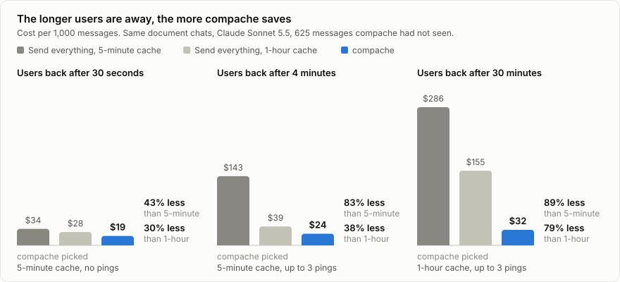

<h1><picture><source media="(prefers-color-scheme: dark)" srcset="docs/assets/logo-dark.svg"></picture></h1>

**Stop paying for your whole chat history on every message.**

[](https://pypi.org/project/compache/) [](https://github.com/BarendPotijk/compache/actions/workflows/tests.yml)   [](LICENCE.md)

compache makes long chats and coding-agent sessions cheaper, with as many answers right. It sits between your app and the model API, sends the part of the history that still matters and makes the most of the prompt cache. You add one line.


<p align="center"><i>Live on Claude Haiku 5.5, as billed. The chatbot already used the 5-minute prompt cache, Claude Code ran as it comes. <a href="#results">All results</a></i></p>

## Highlights

- **A lower bill for the same work.** 42% to 49% less in live chats, 51% to 85% less in long coding sessions.
- **One line.** Wrap the client you have, or type `compache wrap claude`.
- **Nothing to tune.** It learns from your own traffic what later messages need and when users come back.
- **Works with the prompt cache.** It trims when the cache has expired anyway, and keeps it warm when that pays.
- **Nothing is gone for good.** The model can fetch trimmed text back before your app sees the reply.
- **Private.** Runs in your process, has no dependencies and talks only to your model provider.

## Get started

```sh
pip install compache
```

**A coding agent.** One command, nothing to set. Also `codex`, `opencode`, `gemini` and [others](docs/agents.md).

```sh
compache wrap claude
```

**Your own chatbot.** Start with metadata-only recording. This collects sizes, timing and token usage without making a labeling request.

```python
import compache
from anthropic import Anthropic

client = compache.wrap(Anthropic(), record="compache-record")
```

To fit which parts of a chat to keep, supply dependency labels or opt in to `sample=0.1` when recording. Each sampled turn can send the conversation and answer to your model provider in an additional, billable request. The local record keeps sizes and labels. With metadata alone, the chat fit tunes caching and keeps the history. [Recording guide](docs/guide.md#without-past-traces)

```sh
compache fit compache-record --model claude-haiku-5-5 -o policy.json
```

| Who sends model requests? | How to apply the fitted policy |
|---|---|
| **Compache manages requests** | Use `client = compache.wrap(Anthropic(), "policy.json")`. Compache handles reopen calls, fallback requests and keep-warm pings. [SDK guide](docs/guide.md#5-apply) |
| **Your app manages requests** | Use `policy.session(conversation_id)`. Your app sends each call, records its usage, supplies source citations and owns the timer. [Runnable example](examples/quickstart/app_managed.py) |

New fits require 80% training retention by default. Set `--min-retention 0.95` for a 95% minimum. Check the fit on other conversations with `compache replay heldout.jsonl --labels heldout-labels.jsonl --policy policy.json`. The training target and held-out retention are reported separately.

**Or try it first**, on four sample chats, without an API key:

```sh
compache demo
```

```text
Fitted on 4 sample threads, 71 turns (71 labelled) for claude-sonnet-5-5.

Keep questions from the last 4 turns, answers from the last 9 turns and retrieved text from the last turn.
Send up to 1 keep-warm ping while a user is away.
Minimum training retention: 80.00%.
On the training threads, 81.82% of what the labelled turns need from earlier turns stays in view. The rest is fetched back, and that call is in the cost.
$16.10 per 1,000 turns against $50.25 keeping everything: 68% less.
Caching alone, at its best, would cost $18.66.
```

## How it works

Models have no memory, so your app sends the whole conversation again with every message. Prompt caching makes that cheap until the user takes a break and the cache expires. Trimming sends less, but rewrites the history and throws the cache away. compache decides the two together.


1. **It trims when the cache is already gone,** so rewriting the history costs nothing extra.
2. **It keeps the cache warm** with a tiny request while a user is away, if that costs less than losing it, or asks Claude for its 1-hour cache.
3. **It leaves a short notice** where text was trimmed, and the model fetches the text back when it needs it.

Every request is priced by the provider's cache rules on your own conversations, and the cheapest setting wins. [Read more](docs/how-it-works.md)

## Results

Less to pay than without compache, on conversations it had not seen:

| | Live, billed | Modeled |
|:--|:-:|:-:|
| Document chats | 42% to 49% | 43% to 89% |
| Document chats already on the 1-hour cache | 18% | 30% to 79% |
| Coding agents, long sessions | 51% to 85% | – |
| Coding agents, sessions of some 50 calls | 16% | – |
| Coding agents, 174 public runs | – | 5% to 43% |

Live is on Claude Haiku 5.5, modeled on Claude Sonnet 5.5. As many answers were right and as many tasks solved, within chance. The modeled range comes from how long users are away:



It saves least in short chats and where the cache outlasts the breaks: 2% to 5% on GPT-6 Luna, whose cache lasts 30 minutes, with slightly fewer answers right, on too few messages to call. [All benchmarks](benchmarks/README.md)

**What would you save?** Try the [cost calculator](https://barendpotijk.github.io/compache/). Drop a chat log on it: it is read in your browser and sent nowhere.

## Works with

| Your stack | What you add |
|:--|:--|
| Claude Code, Codex, OpenCode, Gemini CLI, Copilot CLI, Aider, Goose and other agents | `compache wrap <agent>` |
| OpenAI, Anthropic and Google GenAI SDKs, sync, async and streaming | `compache.wrap(client, ...)` |
| LangChain and LangGraph | `compache.langchain.middleware(...)` |
| LiteLLM | `compache.litellm.install(...)` |
| OpenAI Agents SDK, Pydantic AI, LlamaIndex, Google ADK, Hermes and [more](docs/integrations.md) | One line each |
| Anything with a base URL | `compache proxy` |

## FAQ

**I already use prompt caching. What does this add?** Sending less, and knowing when. Modeled on document chats it costs [30% to 70% less](docs/comparisons.md) than the cheapest cache setting alone.

**How does it compare with Headroom or Kompressor?** They make each tool result smaller. compache decides which parts are sent at all. Live on the same document chats it was [36% and 26% cheaper](docs/comparisons.md#live), with at least as many answers right. Those chats are prose, and Headroom is made for structured tool output.

**Does it work in serverless functions?** Trimming does: no state is kept outside the process. Keep-warm pings need a process that stays up, so fit with `ping_counts=(0,)`.

**What if something goes wrong?** A request the provider refuses after compache changed it is sent again as your app wrote it.

## Documentation

[Guide](docs/guide.md) · [Agents](docs/agents.md) · [Integrations](docs/integrations.md) · [How it works](docs/how-it-works.md) · [Other tools compared](docs/comparisons.md) · [Benchmarks](benchmarks/README.md) · [Calculator](https://barendpotijk.github.io/compache/) · [Issues](https://github.com/BarendPotijk/compache/issues)

## License

[Apache-2.0](LICENCE.md)
