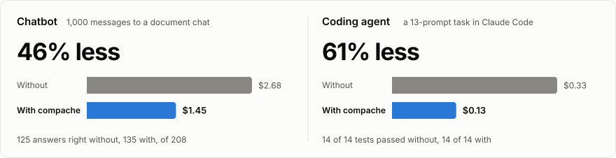

<h1><picture><source media="(prefers-color-scheme: dark)" srcset="docs/assets/logo-dark.svg"></picture></h1>

**Fit prompt caching and context compaction to the conversations your application actually serves.**

[](https://pypi.org/project/compache/) [](https://github.com/BarendPotijk/compache/actions/workflows/tests.yml)   [](LICENCE.md)

Compache is a Python package for chatbots and tool-calling agents. It learns which earlier messages and tool results later turns use, how much context each turn adds, and when users return. A fitted policy decides what to send on the next request and whether a keep-warm request is worth its cost. The model can reopen an archived source when it needs the original text.

[Explore the cost calculator](https://barendpotijk.github.io/compache/) · [Integrate with your stack](docs/integrations.md) · [Developer docs](docs/README.md)



The chart uses provider-billed runs on Claude Haiku 5.5. On five held-out document chats, the fitted policy saved 42–49% across four integrations. On GPT-6 Luna, the same chats saved 2–5%, with 23 of 52 answers graded correct against 24 with full history. [Results and evaluation setup](benchmarks/live/README.md)

## Get started

Use Python 3.11 or later. The bundled demo fits a policy on four sample conversations, prints its estimated cost, and saves it locally. It runs without an API key.

```sh
python -m pip install compache
```

If you're working from a repository checkout, install that revision with `python -m pip install -e .` from the repository root. Then run:

```sh
compache demo -o policy.json
```

<details>
<summary>Demo output from this checkout</summary>

```text
Fitted on 4 sample threads, 71 turns (71 labelled) for claude-sonnet-5-5.

Keep questions from the last 4 turns, answers from the last 9 turns and retrieved text from the last turn.
Send up to 1 keep-warm ping while a user is away.
Minimum training retention: 80.00%.
On the training threads, 81.82% of what the labelled turns need from earlier turns stays in view. The rest is fetched back, and that call is in the cost.
$16.10 per 1,000 turns against $50.25 keeping everything: 68% less.
Caching alone, at its best, would cost $18.66.
```

These are training estimates for 71 turns. [Run a held-out comparison](examples/README.md#fit-and-check-an-unseen-conversation)

</details>

## Add it to your application

| What you have | Where to start |
|---|---|
| A chatbot using the OpenAI, Anthropic, or Google GenAI SDK | Wrap the existing client before the application sends its first request. [SDK integration](docs/integrations.md#sdk-clients) |
| A LangChain agent, LangGraph workflow, or LiteLLM gateway | Choose the adapter for the component that actually sends the model call. [Framework integrations](docs/integrations.md) |
| A service that owns prompt assembly, retries, billing, or timers | Keep one `Policy.session` per conversation. Your application sends the requests and supplies their usage receipts. [Session walkthrough](docs/sessions.md) |
| A coding agent or an application configured by base URL | Start with `compache wrap claude`, or point the application at a local proxy. [Coding agents](docs/agents.md) · [Proxy setup](docs/integrations.md#the-proxy) |

For a chatbot, you can start by recording ordinary traffic. This example wraps an existing Anthropic client. Recording starts when your application uses the returned client.

```python
import compache

client = compache.wrap(client, record="compache-record")
```

The local record contains sizes, timing and token usage. By default recording makes no extra labeling calls. To fit chat compaction, provide dependency labels or opt into sampled labeling. Sampling sends conversation content to your configured model provider in a billable request. With metadata alone, an offline chat fit keeps the full history and tunes caching. [Record or import traces](docs/traces.md)

## Fit, evaluate, apply

Fit on one set of conversations and replay the policy on another. Here the JSONL files are your exports. The labels identify earlier sources that each turn needed.

```sh
compache fit train.jsonl --labels train-labels.jsonl --model claude-haiku-5-5 -o policy.json
compache replay heldout.jsonl --labels heldout-labels.jsonl --policy policy.json
```

Look at cost per 1,000 turns and dependencies kept **before reopening**. A retention target governs training. Held-out retention shows how the chosen policy generalizes. Grade answers separately if answer quality matters to your rollout. [Fit and interpret a policy](docs/fitting.md)

To apply the saved policy in the wrapped-client integration, start your app with `client = compache.wrap(client, "policy.json")` on its original SDK client. Keep sending the conversation history as usual. The [offline chatbot example](examples/README.md#put-a-policy-in-a-chatbot-request) shows what happens when the last question needs a fact from an archived turn.

## Results

| Workload on Claude Haiku 5.5 | Provider-billed cost in USD (without → with Compache) |
|---|---:|
| Document chat, five-minute cache baseline | $2.68 → $1.45 per 1,000 turns |
| Document chat, one-hour cache baseline | $1.80 → $1.48 per 1,000 turns |
| Claude Code, one task in 13 prompts | $0.33 → $0.13 per task |
| Claude Code, 16 issues in one conversation | $0.98 → $0.15 through issue 16 |
| Claude Code, five or six issues per session | $0.059 → $0.050 per session |

The chat rates scale the bills from five held-out conversations to 1,000 turns. The five-minute row averages four integrations. The one-hour row uses the Anthropic proxy. The two long Claude Code rows average two runs per configuration. [Chat results](benchmarks/live/README.md) · [One-hour comparison](benchmarks/compare/README.md#live) · [Coding tasks and scores](benchmarks/agents/README.md#live)

## Documentation

[Developer guide](docs/guide.md) · [Integrations](docs/integrations.md) · [CLI and Python reference](docs/reference.md) · [Troubleshooting](docs/troubleshooting.md) · [How the planner works](docs/how-it-works.md)

## License

[Apache-2.0](LICENCE.md)
