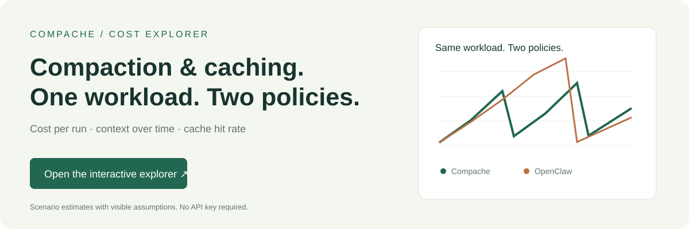
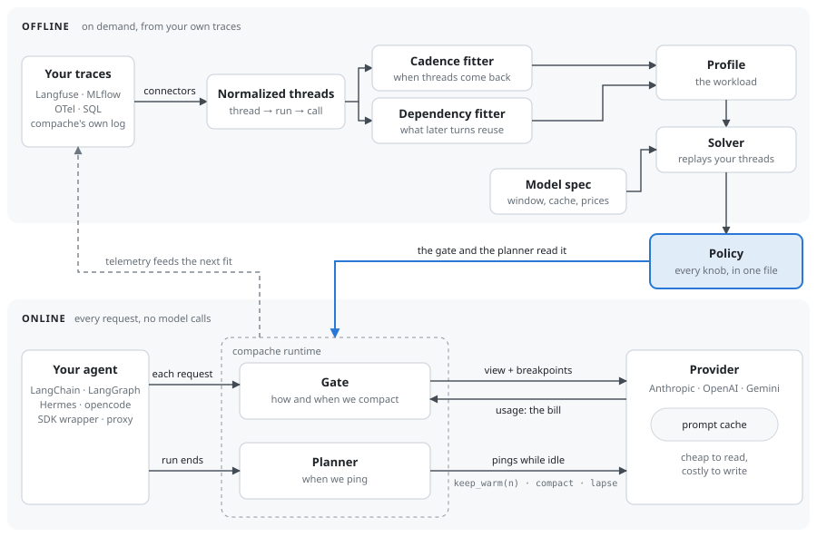
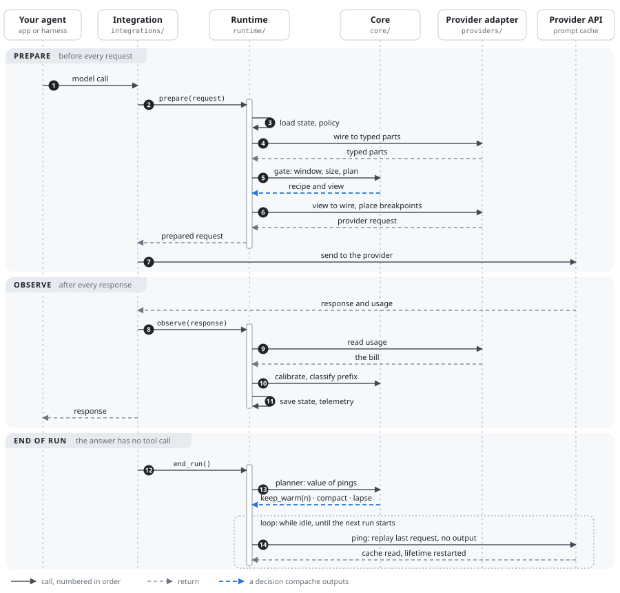

# compache

compache fits a context-compaction and cache keep-warm policy to your own traces, then applies it deterministically on every model request.

**Status (0.4.1):** the standard-RAG optimizer is runnable. It fits return timing and dependency-distance aggregates, searches compaction/retention policies on training threads, and evaluates the winner on separate threads. The package exposes a deterministic retrieval gate, selective recall, bounded source expansion, empirical token calibration and keep-warm decisions. The experimental live runner adds an OpenCode baseline, subscription execution, bounded recovery and per-call usage accounting. Production provider adapters, durable state, invoice calibration and the OpenAI labeling worker remain future work. See the [implementation guide](docs/optimizer.md) for the supported subset.

## Explore your workload interactively

[](https://compache-cost-explorer.barend-potijk2.chatgpt.site)

**[Open the explorer](https://compache-cost-explorer.barend-potijk2.chatgpt.site)**. Run the same calculator locally:

```sh
python3 -m http.server 8765 --bind 127.0.0.1 --directory site
# Open http://127.0.0.1:8765/
```

Choose model economics, retrieval and output tokens, dependency intensity/lookback, thread-length distribution, return probability/delays, and compaction thresholds. Inputs describe one company with one parameter set. Compare cost per run, answer-input cache hit rate and context over a thread. Expand any run to see cache state, protected sources, compaction and keep-warm expected value. Compare 5- and 30-minute windows, share a scenario, or export the ledger.

This is a seeded deterministic **scenario projection of Compache versus OpenClaw's client-summary path**. It includes summary, memory-flush and keep-warm costs; extra recovery calls are zero and recalled input is charged. It is not a runtime benchmark, a port of the Python optimizer, or a claim about all OpenClaw configurations. Dependency identification is assumed perfect; no answer-quality result is inferred. Negative savings and incomplete comparisons remain visible. The existing measured experiments below still use **OpenCode**. See [the methodology and pinned sources](docs/interactive-explorer.md).

For the next document-grounded trace corpus, [the source plan](docs/benchmark-trace-plan.md) recommends **QASPER**, **MuSiQue** for controlled multi-hop cases, and **LongMemEval** for a separate memory check. Authored follow-ups and dependency links remain synthetic. These datasets are not yet inputs to the calculator.

## Run the optimizer

Requires Python 3.11+. The runtime has no external dependencies and these commands make no network requests.

```sh
python3 -m pip install -e .
python3 scripts/run_rag_optimizer.py --output /tmp/compache-evaluation
python3 -m unittest discover -s tests -v
```

The [evaluation fixture](examples/rag_workload/README.md) contains the 45 conversations and 207 actual subagent answers, with the original fabricated customer timings restored and Codex usage counters excluded. Its labels are frozen observational judgments. Model specifications explicitly define illustrative economics and byte-based token estimates; reported savings are not measured provider bills.

For your own normalized traces:

```sh
compache solve --threads threads.jsonl --labels labels.jsonl \
  --model-spec model.json --observation-end 2026-06-21T11:21:27+00:00 \
  --output /tmp/compache-policy
```

Targets are selected from 10%, 15%, 20% and 25% of the configured window. The default historical-dependency coverage floor is 95%; use `--min-dependency-coverage 0.90` for a 90% floor. Warm pressure triggers are 50% or 60%, with 60% the standalone default. Cold returns are the normal opportunity to compact. The [current offline selection](docs/dependency-targets.md) chooses a 20% target and reports both retained requirements and achieved context size.

Use your actual collection cutoff. The command writes the training-selected `candidate-policy.json`, the full `report.json`, and `policy.json`. The latter contains the recommended policy: a candidate only passes offline validation with lower held-out modeled cost, satisfied dependency/admission constraints and complete cost coverage. Otherwise it retains the preserve-all, no-ping baseline; it is null if even that baseline fails admission. Validation never picks another candidate or refits the policy on held-out data.

The [Python API](docs/optimizer.md#python-api) provides `fit_profile`, `optimize`, `replay`, `prepare`, `end_run` and `expand`. Runtime decisions do not read dependency labels or future answers.

## Long-context live comparison

The [long RAG generator](examples/rag_long/README.md) creates separate training and held-out conversations with 15–21k-token retrieval bundles, earlier constraints, source versions and old-evidence dependencies. The [OpenCode adapter](docs/opencode-baseline.md) follows pinned default compaction behavior. The [live runner](docs/live-comparison.md) executes three replicas of each arm using Luna at low reasoning and records every answer, summary, recovery and keep-warm call.

Subscription snapshots carry Codex overhead in their reported usage. Their physical cache counters differ from a persistent integration, so the 5- and 30-minute savings scenarios explicitly model prefix reuse over the same measured calls. See [public benchmark choices](docs/public-benchmarks.md) for the next quality checks.

The [expanded corpus](docs/scaled-rag-workload.md) contains 300 fictional conversations across 30 companies. Its [original result](docs/scaled-rag-results.md) exposed admission failures. Version 0.4.1 narrows citation protection to relevant source occurrences, recalls needed compacted sources without rewriting their earlier placeholders, and calibrates live token estimates from preceding provider usage. See the [repair evaluation](docs/admission-fix-results.md) for completion, dependency and cost results and their limits.

## Try the first milestone

Requires Python 3.11 or newer; the package has no runtime dependencies.

```sh
python3 -m pip install -e .
compache traces validate benchmarks/rag_v1/threads.jsonl
compache dependencies prepare --threads benchmarks/rag_v1/threads.jsonl --thread-id rag-001 --run-id rag-001-run-03 --output /tmp/compache-packet.json
python3 -m unittest discover -s tests -v
```

The [benchmark](benchmarks/rag_v1/README.md) contains 45 fictional threads, 207 runs and 15 question families across three companies. It exercises earlier user constraints, retrieved context, prior answers, alternative evidence, version changes and missing content. Timing is simulated; token usage is unknown. Its 45 final-run expectations are authored test cases, not measured causal necessity or production workload frequencies.

Use the [dependency-labeling skill](skills/compache-label-dependencies/SKILL.md) to annotate prepared packets with your coding agent. Its scripts call the same package functions and validator as the CLI. The [contract documentation](docs/trace-contracts.md) describes the supported offline Langfuse envelope, source identities and coverage rules. These commands need no API keys and make no network requests.

## Runtime architecture roadmap



- **Offline:** two fitters describe your workload, and the solver combines that with the provider's prices into one policy file.
- **Online:** the gate decides how and when to compact, and the planner decides when to ping. Neither calls a model, so the same inputs always give the same request.

## One request through the layers



- **Prepare:** the gate decides the view before the request leaves.
- **Observe:** the bill comes back, and the runtime calibrates and records it.
- **End of run:** the planner decides, and pings repeat while the thread is idle.

The blue arrows are the two decisions compache outputs. The order the layers get built in is in the [build plan](docs/design.md#build-plan).

## Open design choices

This list describes the broader roadmap. The shipped RAG subset settles prompts/answers as verbatim, retrieves only bounded source pages, uses explicit in-memory state, defaults to 95% historical-requirement coverage and zero changed unknown-context runs, and returns `keep_warm` or `lapse`. See the implementation guide for other differences from the full design.

Already settled: [statistical fitters, no shipped return curve, Python 3.11 and up](docs/design.md#decided).

**Gate and planner**

1. **Prompts and answers.** Do they always stay verbatim, or may a fitted policy reduce old ones? Proposed: verbatim in the first version, with their reuse reported.
2. **Reference defaults.** Ship the current thresholds as they are, or derive them again from public or synthetic threads first?
3. **The `compact` action.** Keep it, or let the planner only ping or lapse? Its useful band is narrow.
4. **Request-scoped block.** Which single position holds from the first request on?
5. **Preserved thinking.** Replacing a result an earlier response read may be rejected on models that bind thinking blocks to unedited history. How does a rewritten view avoid that?
6. **Unbounded tool results.** A turn reading large documents on a small window can loop, with the model expanding what the shed just replaced. Where are results bounded, and what guards the shed?
7. **Fork carry.** What does a cold plan build on when the stored digest no longer matches? The safe answer is nothing.
8. **Unknown model.** Observe only, assume a default window, or fail? Proposed: observe only.
9. **Citations and protected evidence.** Core, or optional?
10. **Three compaction rules to confirm.**
    - Tier 2 stops at the target and never keeps one more turn past it.
    - Tiers 1 and 2 never touch the running turn. Only the allowance, the last resort and admission do.
    - A capability can be unloaded on a cold start where only tier 1 fires.

**Fitting and solving**

11. **Miss ceiling.** What share of turns may need an expansion before the solver rejects a policy? To be set from the first real traces.
12. **Profile scope.** One profile per application, or one per agent or segment inside it? Proposed: per application first.
13. **Evaluation dataset.** Which threads do we judge the defaults and the solver against?

**Integration**

14. **First targets.** Proposed: Anthropic then OpenAI, Langfuse then MLflow, LangChain then Hermes then opencode.
15. **Hosts that aren't Python.** Proposed: a local service with a thin plugin, a proxy as the fallback, and no TypeScript port.
16. **Built-ins that can't be switched off.** When a host places its own cache breakpoints, does compache stand down to audit, or run beside them?
17. **State and pings.** Which stores ship first, and do pings run in-process or go to the host's own queue? Proposed: in-memory and SQLite, in-process by default.
18. **Own telemetry.** Is the runtime's content-free log on by default? Proposed: yes, kept local.

**Project**

19. **Licence.** Needed before the first release.
20. **Development interpreter.** `.python-version` and the package floor now use Python 3.11.
