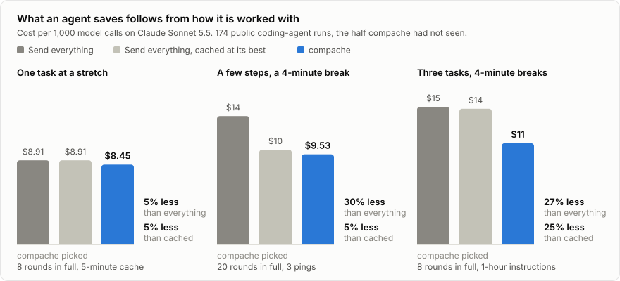

# Agents

What an agent's calls cost with and without compache: modeled on public runs, and live with Claude Code and Codex next to Headroom and OptScale Kompressor.

@@FIGURE@@

@@LIVE@@

## Modeled

174 runs of [SWE-rebench with OpenHands](https://huggingface.co/datasets/nebius/SWE-rebench-openhands-trajectories) (CC-BY-4.0), 64 calls each. The policy is fitted on every second run and priced on the others, by the provider's list prices and cache rules, fetching back included. The runs carry no times: a call takes eight seconds, a tool three, and a user is back after a while that is drawn around the median.



| Less than everything on the default cache | Claude Sonnet 5.5 | Claude Haiku 5.5 | GPT-6 Luna |
|:--|:-:|:-:|:-:|
| One task at a stretch | 5% | 17% | 8% |
| Three tasks, back after 30 seconds | 20% | 79% | 28% |
| Three tasks, back after 4 minutes | 23% | 80% | 28% |
| Three tasks, back after 30 minutes | 30% | 81% | 30% |
| Eight calls a prompt, back after 30 seconds | 7% | 20% | 9% |
| Eight calls a prompt, back after 4 minutes | 29% | 32% | 10% |
| Eight calls a prompt, back after 15 minutes | 43% | 44% | 18% |

85% to 96% of the calls that rely on an earlier result find it in view, and 0.4% to 1.5% of all calls fetch one back. Haiku's list price is five times higher for a request above 100,000 tokens, which three tasks in a row reach.

## How the live runs are made

| | |
|---|---|
| Issues | [SWE-bench Lite](https://www.swebench.com)'s sympy issues that run without a container: kept where the fix's tests fail before and pass after on this machine, graded by those tests |
| A session | Five or six issues in one checkout, one prompt each, and between them the user is away for 60, 20, 420, 120 and 780 seconds |
| A long session | A generated package (`tasks.py`): fourteen modules to correct, then to test, review, document and check against random inputs, in thirteen prompts. Graded by hidden tests |
| A day | All seventeen issues in one conversation, with breaks of 20 to 420 seconds |
| Models | Claude Haiku 5.5 in Claude Code 2.1.331, GPT-6 Luna in Codex 0.172.0, through OpenRouter, billed on 2026-11-24 and 2026-11-25 |
| compache | What `compache wrap` starts, learning from nothing. `learned` after `compache learn`, on the sessions of the first arm on other tasks |
| Headroom 0.45.0, Kompressor 1.6.1 | Their proxies, with their defaults and with the settings the package ships |

Agents and tools hold no key: the last server on the way puts it in and reads the bill. They run in a sandbox that reaches this machine only.

```sh
python benchmarks/agents/public.py fetch runs && python benchmarks/agents/public.py price runs --output docs/assets/data/agents.json
python scripts/figures.py agents

python benchmarks/agents/swe.py swe                              # needs swe/venv: Python 3.9 with mpmath 1.3 and pytest
python benchmarks/agents/run.py play --agent claude --swe swe --session --repeats 2 --env .env --headroom headroom --kompressor kompressor
python benchmarks/agents/run.py play --agent claude --long --tasks 2 --env .env
python benchmarks/agents/run.py play --agent claude --swe swe --day --tasks day --pause 60 20 420 45 330 90 --env .env
python benchmarks/agents/run.py report
python benchmarks/agents/run.py priced --agent claude            # the first arm's sessions, priced under compache
```
