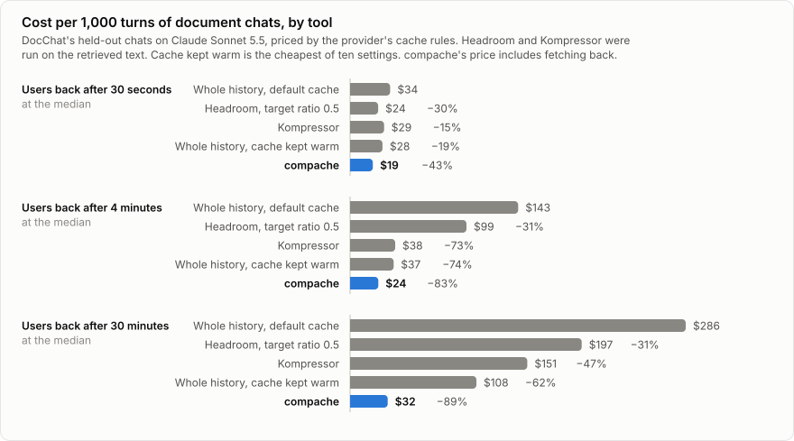

# Compare

What other tools make of [DocChat](../docchat/README.md)'s held-out conversations, and what their requests would cost. Results on [Other tools compared](../../docs/comparisons.md).



| Arm | How it is priced |
|---|---|
| Whole history, default cache | Every request whole, five-minute entries, no pings |
| Headroom | `compress()` was run on every turn's retrieved text. What it left is sent and cached like the whole history |
| Kompressor | Its `compress` command on the same text, under its rule for the cache: five-minute entries until a conversation first pauses past five minutes, one-hour entries from then on |
| Whole history, cache kept warm | The cheapest of ten settings: five-minute and one-hour entries with up to 0, 1, 3, 6 or 8 pings, sent when compache's planner finds that one pays |
| compache | Fitted on the 15 training threads, cache lifetime included, and replayed on the 15 held-out ones, fetching back included |

No model is called and no answer is compared. Prices are Claude Sonnet 5.5's on 2026-11-20, a one-hour entry costs twice the input price to write. The whole history is priced twice, here and by compache's replay, and the two have to agree.

```sh
export PYTHONPATH=src

# In an environment with headroom-ai[proxy]. Without --text-model it is the base install.
python benchmarks/compare/run.py shrink --tool headroom --text-model --target-ratio 0.5 \
  --name "Headroom, target ratio 0.5" --data docchat-mixed --output headroom.json

python benchmarks/compare/run.py shrink --tool kompressor --binary ./kompressor \
  --name Kompressor --data docchat-mixed --output kompressor.json

python benchmarks/compare/run.py price --data docchat-fast docchat-mixed docchat-slow \
  --sizes headroom.json kompressor.json --output docs/assets/data/compare.json
python scripts/figures.py compare
```

`--shape json` hands the passages over as a JSON list. Headroom's text model took some 35 minutes for the 625 turns. The output holds sizes only, never text.
