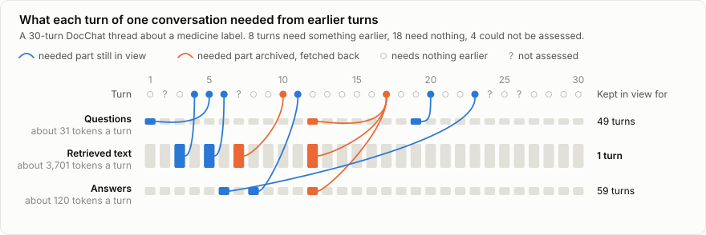

# DocChat

Long chats over public documents, built to answer one question: **what does a turn need from earlier turns?** In DocChat that is measured, not assumed, so a context policy can be judged on what it actually loses.



Each column is a turn and each row a kind of part. Most turns need nothing earlier. Those that do reach for a question, an answer or a passage, often from the turn before and now and then from far back: turn 23 needs an answer given 17 turns earlier. Retrieved text is 95% of the tokens, and one turn in eight needs any of it again. compache reads this structure off the threads. Here it keeps questions and answers for some fifty turns, keeps retrieved text for one turn and fetches the occasional older passage back. A rule that keeps the last few turns, or summarizes at a size limit, uses none of this.

## What is in it

| Domain | Chat experience | Source | Licence |
|---|---|---|---|
| `finance` | Working through a company's annual report | Form 10-K filings, [EDGAR-CORPUS](https://huggingface.co/datasets/eloukas/edgar-corpus) | Apache-2.0 |
| `legal` | Reviewing a commercial contract | [CUAD v1](https://huggingface.co/datasets/theatticusproject/cuad) | CC BY 4.0 |
| `healthcare` | Asking about a medicine from its official label | [openFDA drug labelling](https://open.fda.gov/apis/drug/label/) | Public domain, CC0 |
| `support` | Getting help from product documentation | [Kubernetes documentation](https://github.com/kubernetes/website) | CC BY 4.0 |
| `hr` | Asking an internal handbook about policies | [TTS Handbook](https://github.com/GSA-TTS/handbook), US General Services Administration | Public domain, CC0 |

| | First build |
|---|---|
| Threads | 30: for each of 10 documents one of 8 to 12, one of 25 to 35 and one of 70 to 90 turns |
| Turns | 1,227 |
| Split | 15 threads to fit on, 15 held out, by document |
| Tokens per turn | Question 36, retrieved text 3,653, answer 139 |
| Longest threads | 240k to 350k tokens |
| Turns that need earlier context | 29%. 58% do not, 14% could not be assessed |
| Return patterns | Three builds of the same text: users back after 30 seconds, 4 minutes or 30 minutes at the median |

| Part | Where it comes from |
|---|---|
| Document text | Public files, pinned by revision and content hash |
| What is retrieved each turn | BM25 over the document, run on the user's own words |
| User messages and reference answers | Written by Claude Haiku 5.5 from one planned excerpt and the earlier turns it builds on |
| **Which turns need history, and which earlier parts** | **Measured.** Haiku answers each turn again with parts of the history withheld, and Claude Sonnet 5.5 grades every answer |
| Who asks, the mix of turn types, thread length, timing | Declared in [`domains.json`](domains.json) and at the top of [`docchat.py`](docchat.py) |

## What the measurement shows

| Domain | Turns | Need history | Do not | Not assessed |
|---|---|---|---|---|
| `finance` | 244 | 31% | 51% | 18% |
| `legal` | 242 | 38% | 55% | 8% |
| `healthcare` | 254 | 28% | 58% | 14% |
| `support` | 254 | 22% | 60% | 18% |
| `hr` | 233 | 27% | 64% | 9% |

- **How far back.** Of the 354 turns that need history, the nearest sufficient evidence is one turn back for 53%, two to five for 22%, six to twenty for 18% and further for 7%.
- **Which kind.** Earlier retrieved text alone is enough for 45% of them, earlier answers alone for 38% and earlier user messages alone for 21%.
- **Planned is not needed.** Half of the planned follow-ups and two thirds of the planned recalls turned out to need no history: in 96% of those cases the retriever had fetched the passage again. One plain lookup in ten did need the previous turn.

## Result with Claude Sonnet 5.5

`compache fit` chose the same cut for all three return patterns: keep the questions of the last 49 turns and the answers of the last 59, and keep retrieved text for one turn. Only the pings differ.

| Users back after | Pings | Keep everything | Fitted policy | Saving |
|---|---|---|---|---|
| 30 seconds | None | $34 | $19 | 43% |
| 4 minutes | Up to 3 | $143 | $24 | 83% |
| 30 minutes | Up to 3 | $286 | $43 | 85% |

Cost per 1,000 turns on the 15 held-out threads (625 turns), at list prices and a five-minute cache, including the cost of fetching back what the cut archived. A cut waits for a return that finds the cache cold. Where users are back in 30 seconds the policy keeps 57% of the history tokens, and 92% of the 181 held-out turns that need history still have enough of it in view. Where they take 30 minutes it keeps 15%, and 76%. It was the cheapest of the 21 policies the fit priced in two of the three cases and within 3% in the third: the [policy map](../../README.md#why-fitted-beats-default) shows all of them.

Then Sonnet 5.5 answered 30 held-out turns twice, and Sonnet 5.5 graded each answer against the turn's key facts.

| Turns | Full history | Policy's view |
|---|---|---|
| All 30 | 25 correct | 24 correct |
| 20 that need history | 16 correct | 14 correct |
| 10 that do not | 9 correct | 10 correct |
| Mean request | 120k tokens | 26k tokens |

The model never called the reopen tool: where the policy's view lacked something, it answered from what it could see. One turn is three points here, and 24 of the 30 turns come from long threads.

## How a thread is built

| Step | What happens |
|---|---|
| Plan | A seeded outline picks a persona, a length and, for every turn, a type and an excerpt. Excerpts follow a reader's path through the document: mostly nearby, sometimes a jump |
| Write | Haiku writes the user message and a reference answer from the planned excerpt and the earlier turns. A turn the material cannot carry becomes a plain lookup |
| Retrieve | BM25 returns the six best chunks for the user message. The planned excerpt is always among them |
| Verify | Haiku answers the turn from the current retrievals plus one set of earlier parts at a time. Sonnet checks that the reference answer is supported, writes one to four key facts and grades each answer against them |
| Label | No history needed: the answer with nothing earlier shown was correct. History needed: that answer was wrong and at least one set made it right. Not assessed: no set gave a correct answer, or the reference was unsupported |

Turn types: `lookup` asks something new, `follow_up` asks on from the previous turn, `recall` returns to an old topic, `compare` sets an earlier answer against a related excerpt, `user_context` asks "in my case" after the user stated a fact about themselves, `reuse_output` asks for an earlier answer in another form, `synthesis` asks for a summary of several turns. The plan only proposes a dependency. The label is what the measurement found.

## Build and run

```sh
python benchmarks/docchat/docchat.py build --cache dl --work work --output docchat-mixed --clock mixed

export PYTHONPATH=benchmarks/docchat
python benchmarks/docchat/run.py cost --data docchat-fast docchat-mixed docchat-slow --output cost.json
python benchmarks/docchat/run.py answers --data docchat-mixed --recipe '<recipe from cost.json>' --work work --output answers.json
```

- Model calls go through the `claude` command line under your own login. Every answer is stored in `work/calls`, so a stopped build resumes and a second build with another `--clock` asks nothing new. `--dry-run` plans without calling a model.
- `--docs`, `--short`, `--medium` and `--long` set the size. `--clock` is `fast`, `mixed` or `slow`, or `tracelab`, which follows quantiles published for coding-agent sessions.
- A third of each domain's documents is the held-out set, chosen by hash of the document ID. Threads follow their document.
- Output: `traces/`, `labels/`, `grading/` and `manifest.json`, one file per thread. `compache fit docchat-mixed/traces --labels docchat-mixed/labels --model claude-sonnet-5-5` reads them directly.
- The first build took 6,262 writer calls and 1,227 judge calls, about $35 at list prices. The 30-turn answer run took 106 calls and $23, almost all of it the full-history side.
- `run.py grid` and `run.py thread` write the data behind the two figures, which `scripts/figures.py` draws.

## Limits

- The turn mix, personas, lengths and return patterns are assumptions. Report results by domain and turn type, not as one number.
- One retriever. A pipeline that rewrites the query from history fetches old evidence more often and needs history less.
- The writer and the withheld-history answerer are the same model, and the grader is a model. No person has checked the reference answers.
- Each alternative is a set that was enough, not proof that every part in it was needed.
