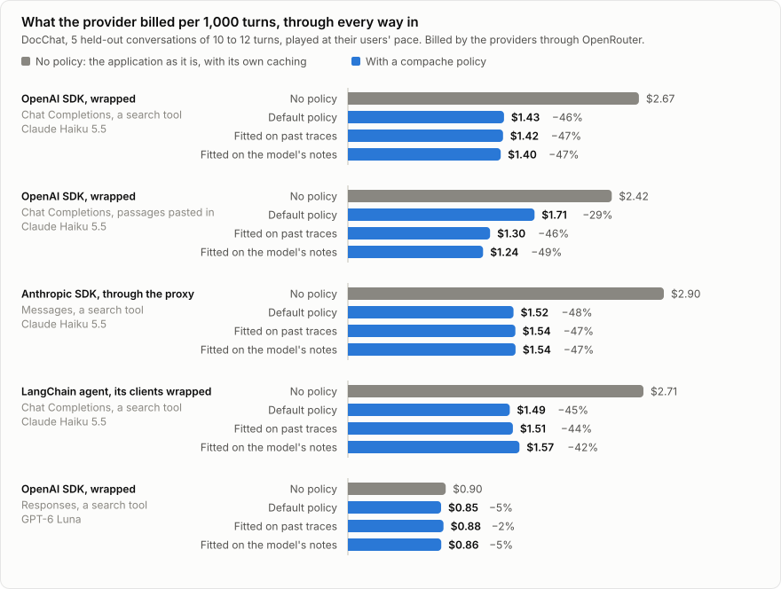

# Live model calls

compache in the request path of real conversations, and what the provider billed for them. Five ways in, with no policy and with three, on the same held-out conversations played at their users' own pace.



- **About half off on Claude Haiku 5.5.** Its cache lasts five minutes. The policies fitted to these conversations cut the bill by 42% to 49% through all four ways in played on it, and as many answers were right.
- **Next to nothing to cut on GPT-6 Luna.** Its cache lasts thirty minutes and these users were back within seven, so keeping everything is cheap. The policies saved 2% to 5%. On the ten turns that need earlier context they got 1 or 2 right against 4 without a policy: too few turns to call, and not worth the risk for a saving this small.
- **No traces needed.** A policy fitted on a record without any text, with the model's own notes for labels, saved 46% on average across the Claude ways, as did a policy fitted on the chat logs with measured labels.
- **The default is a start, not a fit.** It assumes search results come back as tool results. Where the application pastes the passages into the question instead, it saved 29% and got 8 turns wrong that were right without it, against 1 the other way. Fitted on that shape: 46% and 49% saved, and as many answers right.

## Answers

| Graded correct | No policy | Default | Past traces | Model's notes |
|---|:-:|:-:|:-:|:-:|
| Claude Haiku 5.5, four ways in, 208 turns | 125 | 118 | 135 | 132 |
| GPT-6 Luna, 52 turns | 24 | 24 | 23 | 20 |

Claude Haiku 5.5 graded each answer against the key facts DocChat holds for its turn, strictly: an answer that misses one fact is wrong, which keeps the share low under every policy. Apart from the default on pasted passages (p = 0.04), no policy's answers differ from those without one beyond chance: paired turn by turn over the four Claude ways p = 0.10 to 0.39, on GPT-6 Luna 0.42 to 1.0.

## What was played

| | |
|---|---|
| Conversations | [DocChat](../docchat/README.md), the build whose users are back after 4 minutes at the median. 15 training conversations cut to 6 to 14 turns, to fit on. The 5 short held-out ones, 10 to 12 turns, to apply on |
| Pace | Every turn waited as long as its user did, up to 7 minutes. Conversations ran side by side, each with cache entries of its own |
| Shapes | The application gives the model a search tool, or pastes the passages into the question. Every policy was fitted for its shape and its model's prices |
| Models | Claude Haiku 5.5 on four ways in, GPT-6 Luna on one, through OpenRouter, each pinned to its own provider |
| No policy | The application as its guide writes it: Claude's requests carry one cache mark for the whole request |
| Default | `compache.default_policy(model)`, fitted on the calculator's default workload |
| Past traces | Fitted on the training conversations' chat logs, with DocChat's measured labels |
| Model's notes | Fitted on a record of the training conversations without text, the model asked after each reply which earlier parts it needed |

## The model's notes

On the training conversations, against DocChat's measured labels:

| | Search tool | Pasted passages |
|---|:-:|:-:|
| Turns that need earlier context | 30 | 30 |
| The note names all of one sufficient set | 9 | 16 |
| The note names something | 22 | 23 |
| Turns that need nothing earlier | 78 | 81 |
| The note names nothing | 42 | 38 |

The notes are loose: half the time they name something on a turn that needs nothing, and of the 16 follow-ups that need the question and the answer of the turn before, they name both for 1. Where it counts they agree with the measurement: on how long retrieved text is needed, and retrieved text is nearly all the tokens. With the search tool both fits keep it for one turn, with pasted passages for two and three.

The count of notes matters, not the rate. Some 60 notes gave the same cut as all 120, to within a turn. 30 gave it with the search tool but kept pasted passages for one turn instead of three, and 6 to 10 were off in both shapes. At `sample=0.1` 60 notes take some 600 turns of traffic.

A note after the reply cost about half of what a turn does, most of it the model's thinking before it wrote the line. At `sample=0.1` that adds some 5%.

## A note after the reply, or in it

`notes="inline"` asks in the reply's own request. That saves a request, but the model then answers a request with one more paragraph in it. On the four-question check conversation:

| All four facts right | No notes | Note after the reply | Note in the reply |
|---|:-:|:-:|:-:|
| Gemini 3.5 Flash Lite, Chat Completions | 8 of 8 | 8 of 8 | 5 of 8 |
| Claude Haiku 5.5, Messages | 10 of 10 | 10 of 10 | 8 of 10 |
| Claude Haiku 5.5, Chat Completions | 12 of 12 | 8 of 8 | 12 of 12 |
| GPT-6 Luna, Chat Completions | 8 of 8 | 8 of 8 | 8 of 8 |

In the reply the note also takes output room: on Claude Haiku 5.5, 5% to 8% of asked replies reached the application's output limit and were asked again without it. A policy fitted on notes carried in the reply saved 45% to 49% on the Claude ways, as much as one fitted on notes asked after it.

## Every way in

Four questions on a pump manual, the fourth about the first, under a policy that archives retrieved text as soon as it may. Every way passed the conversation through, archived the passage, let the model fetch it back, took a note and showed the application none of it:

| Way in | Model | Facts right | Parts archived | Fetched back | Notes | Labels shown |
|---|---|:-:|:-:|:-:|:-:|:-:|
| OpenAI SDK, Chat Completions | Claude Haiku 5.5 | 4 of 4 | 6 | 1 | 3 of 3 | 0 |
| OpenAI SDK, Chat Completions, streamed | Claude Haiku 5.5 | 4 of 4 | 6 | 1 | 3 of 3 | 0 |
| OpenAI SDK, Chat Completions | GPT-6 Luna | 4 of 4 | 4 | 1 | 3 of 3 | 0 |
| OpenAI SDK, Chat Completions | Gemini 3.5 Flash Lite | 4 of 4 | 4 | 1 | 3 of 3 | 0 |
| OpenAI SDK, Chat Completions, passages pasted in | Claude Haiku 5.5 | 4 of 4 | 5 | 6 | 3 of 3 | 0 |
| Anthropic SDK, Messages | Claude Haiku 5.5 | 4 of 4 | 6 | 9 | 3 of 3 | 0 |
| OpenAI SDK, Responses | GPT-6 Luna | 4 of 4 | 4 | 1 | 3 of 3 | 0 |
| OpenAI SDK through the proxy, Chat Completions, streamed | Claude Haiku 5.5 | 4 of 4 | 6 | 2 | 3 of 3 | 0 |
| Anthropic SDK through the proxy, Messages | Claude Haiku 5.5 | 4 of 4 | 6 | 1 | 3 of 3 | 0 |
| LangChain agent | Claude Haiku 5.5 | 4 of 4 | 6 | 2 | 3 of 3 | 0 |

## Run it

```sh
python benchmarks/live/run.py check  --work runs --env .env
python benchmarks/live/run.py learn  --work runs --env .env --data docchat-mixed
python benchmarks/live/run.py fit    --work runs --data docchat-mixed
python benchmarks/live/run.py apply  --work runs --env .env --data docchat-mixed
python benchmarks/live/run.py report --work runs --figure docs/assets/data/live.json
python scripts/figures.py live
```

The key is read from `OPENROUTER_API_KEY`, or from the file given with `--env`. Every command stops before it bills more than `--budget`. Billed through OpenRouter, `check` cost $0.02, `learn` $0.52, and `apply` $1.75 plus some $0.35 for grading, in about an hour. `docchat-mixed` is a DocChat build made with `--clock mixed`.

Not run here: the OpenClaw and Hermes settings, which come from their documentation, and Gemini's own API, which OpenRouter does not serve and which was checked against a local stand-in only.
