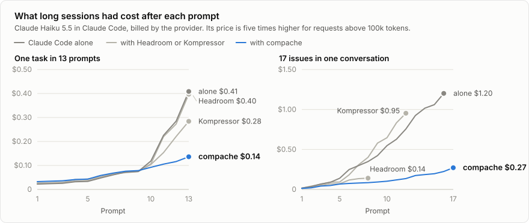

# Agents

```sh
pip install compache
compache wrap claude
```

An agent makes dozens of model calls per message, and every call sends every tool result so far. compache goes between the agent and the model, keeps in view what its next steps rely on, and keeps the cache warm while a tool runs. The agent itself is left as it is.


| | |
|---|---|
| `compache wrap claude` | Claude Code. Also `codex`, `opencode`, `gemini`, `qwen`, `aider`, `goose`, `crush`, `copilot`, `kilo`, `pi`, `openhands` |
| `compache wrap codex -- exec "fix the failing test"` | With arguments of its own |
| `alias claude='compache wrap claude --'` | Every session, from your shell's profile |
| `compache wrap -- my-agent` | Any other command. It is told by the variables that SDKs read |
| `compache wrap --watch claude` | Record only, and change nothing |
| `compache wrap --print claude` | Show the proxy to start and what to set, for an agent in an editor or one that is always on |
| `compache learn claude --from claude` | Start from the sessions Claude Code keeps on this machine. Also `codex` |
| `compache stats` | What was saved, per agent and model. For Claude Code's status line: `"statusLine": {"type": "command", "command": "compache stats claude --line"}` in its settings |
| `compache doctor` | Whether it works here, and what it can be used with |

`wrap` starts a proxy on a free local port, starts the agent with its base URL set to it, and says at the end what the session cost and what it would have cost. No file of the agent's is changed, and a session that began with compache goes on without it, or the other way round. Where the agent's own settings or command line name a server, such as a gateway, requests go on to that. Where a project's file names another one, or a key is none of the provider's own, nothing is sent until `--upstream URL` says where. On a subscription nothing is billed by the token: what is saved there is room in the window and in the plan's limits.

## What it does

| Moment | What happens |
|---|---|
| A tool returns | Its result goes out in full, and stays for as long as it is one of the newest |
| Older results outweigh what follows them, or the request has reached a size that is billed dearer | They become a notice. Rewriting what follows pays for itself in the next calls |
| The cache has expired | They become a notice at once: everything has to be paid for again anyway |
| What the model reasoned before | Goes with the results of its time. It is sent again with every call and takes as much room as they do. Claude only takes it back behind what it was made behind, so a cut takes all that stands behind it |
| The model needs one after all | It calls `reopen`. The agent never sees the call, and what it fetched stays in view until it is old. Once it fetches the same again, results stay twice as long in this conversation |
| A tool takes longer than the cache lives | The same request goes out once more with next to no output, which keeps the cache |
| Somebody is back after a break | The instructions and tools that open every request are read from an entry that lives an hour |

How many rounds of results stay, when a cut pays, how many pings and which lifetimes are learned. A cut leaves a cache mark where the next one will begin, so the provider still reads what comes ahead of it.

## How it learns

- **It starts from public runs.** The policy for the first session was fitted on 174 coding-agent runs and keeps the newest 8 rounds in full.
- **It goes on from yours.** After some 200 calls, and again whenever that has grown by half, it is fitted on what is on record in `~/.compache/<agent>`, per model, in the seconds after a session. `compache learn claude --from claude` adds the sessions Claude Code or Codex kept before, so that it need not wait.
- **No labels.** A reply that repeats a line which only a tool had returned shows which result it relied on. Those lines are held as hashes while the conversation runs, and the record keeps which result it was, never the line.
- **It stays honest.** A policy that hides results hides that they were needed. So one conversation in ten goes out as the agent wrote it. Those say what replies rely on, and what the others save.
- **No text.** The record holds sizes, times and usage. Conversations go by a hash.

At least 85% of the calls that rely on an earlier result find it in view, or no more than 1 call in 100 misses one. Those are priced as fetching it back.

## In your own agent

```python
client = compache.wrap(Anthropic(), learn="compache-record")        # or OpenAI(), genai.Client(), async clients
```

```python
live = compache.Live(learn="compache-record")
agent = create_agent(model, tools, middleware=[compache.langchain.middleware(live)], checkpointer=saver)
```

```sh
compache proxy --learn compache-record                              # anything else with a base URL
```

Every way in of the [integrations](integrations.md) takes `learn`. To decide yourself when a policy changes, record with `record="compache-record"`, fit with `compache fit compache-record -o policy.json` and give the file: an agent's traffic is recognized by its loops, and needs no labels. `compache default --agent --model claude-sonnet-5-5` writes the policy that learning starts from.

With your own prompt assembly, a session decides call by call:

```python
session = policy.session("task-17")
turn = session.prepare(question)
...
session.replied(turn, reply_text, tool_arguments, usage=response.usage)
turn = session.extend(turn, tool_results)          # one round of tool calls. turn.archived_ids went out as a notice
...
session.complete(turn, answer, usage=response.usage)
```

## What it saves



Live, 67% and 85% less on long sessions and 16% less on sessions of some fifty calls, with as many solved. [Agent benchmarks](../benchmarks/agents/README.md): real sessions with Claude Code and Codex next to Headroom and Kompressor, and the numbers below.

Modeled on the public runs, fitted on half of them and priced on the other half, against sending everything on the provider's default cache:

| | Claude Sonnet 5.5 | Claude Haiku 5.5 | GPT-6 Luna |
|:--|:-:|:-:|:-:|
| One task at a stretch, 64 calls | 5% | 17% | 8% |
| Prompts of eight calls, back after 30 seconds | 7% | 20% | 9% |
| Prompts of eight calls, back after 4 minutes | 29% | 32% | 10% |
| Prompts of eight calls, back after 15 minutes | 43% | 44% | 18% |
| Three tasks in a session, back after 4 minutes | 23% | 80% | 28% |
| Three tasks in a session, back after 30 minutes | 30% | 81% | 30% |

- **Breaks are where most of it is.** Part of that is caching alone: pings and the right lifetimes save 25% of the 29% in the third row on Sonnet. Trimming is the other part, and grows with the length of a session.
- **Long sessions on Haiku** pass 100,000 tokens, where its list price is five times higher. A cut keeps them below.
- **Short sessions save nothing.** A task that is done in ten calls has nothing to trim, and compache's tool costs it 1%.
- **About 1 call in 85** fetches something back.
