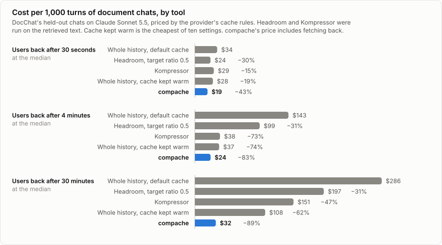
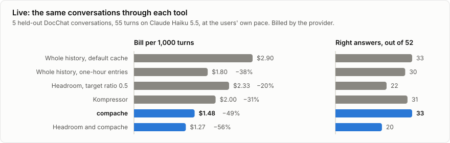
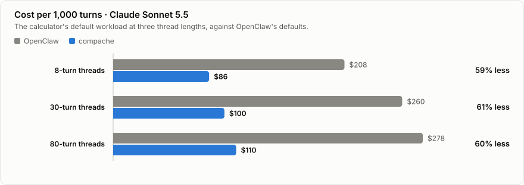

# Other tools compared

Tools for this bill come in two kinds. **Cache tools** keep the whole history and keep it cached. **Compressors** make single results smaller. compache decides what stays in the request and when the cache is worth keeping, together, from your own conversations. The [calculator](https://barendpotijk.github.io/compache/) prices your workload against all of these and against your own rules.

- **Against the best a cache tool can do,** compache costs 30%, 35% and 70% less. That bar is the cheapest of ten settings, five-minute or one-hour entries with up to eight pings, picked on the very chats it is priced on.
- **Against a compressor,** 19% to 84% less than Headroom and 33% to 79% less than Kompressor. Retrieved prose compresses little: by a third at Headroom's setting for documents, by 3% in Kompressor.
- **Modeled.** The chats are the 15 held-out [DocChat](../benchmarks/docchat/README.md) threads, 625 turns, at Claude Sonnet 5.5 list prices. compache keeps 92%, 85% and 88% of what these turns need in view and pays for fetching back the rest. [Run it](../benchmarks/compare/README.md).

## Live

- **compache has the lowest bill with the answers of the whole history.** 49% less than the whole history, 18% less than the whole history on one-hour entries, 26% less than Kompressor, 36% less than Headroom.
- **Headroom's setting for documents costs answers.** It takes a third of the words out of prose: 22 right against 33 (p = 0.03), and 20 together with compache (p = 0.002). Its README says to skip prose, and its defaults leave it nearly whole. What it is made for, tool output with structure, is not in these chats.
- **Kompressor saved no tokens** on this prose. What it saved here is its one-hour entries.
- **The rest is within chance** (p = 0.51 to 1.00).

Five short held-out chats, 10 to 12 turns each, played by the same application on Claude Haiku 5.5, users back after four minutes at the median and never after more than seven. Billed through OpenRouter on 2026-11-24, the whole history on 2026-11-23. Claude Haiku 5.5 graded 52 answers per tool against DocChat's key facts, strictly: one missed fact is wrong. p-values are paired by turn, against the whole history.

## Coding agents

- **In long sessions compache has the lowest bill, with as many answers right.** On one task in thirteen prompts 66% less than Headroom and 53% less than Kompressor, all tests passed with each. On the day's first eight issues 40% and 79% less.
- **In short sessions little separates them.** Sessions of five or six issues with Claude Code cost 11% and 10% less than with Headroom and Kompressor, and with Codex the three are within what the agent's own choices move.
- **Where it comes from.** A compressor makes each new result smaller, and all of them are sent with every call. compache lets old ones go, at the calls where that is cheap.

Claude Haiku 5.5 in Claude Code and GPT-6 Luna in Codex, billed through OpenRouter on 2026-11-24 and 2026-11-25. The other tools' runs of the day end where their money did. [Every number, and how they were run](../benchmarks/agents/README.md)

## What each does

| Tool | What it does | While a user is away | Fitted to traffic | Compared how |
|---|---|---|---|---|
| compache | Keeps in view what later turns need, trims when the cache has expired, fetches back | Pings while they pay, or one-hour entries | What stays, the pings and the entries' lifetime | |
| caching.ai | Keeps every token, and the provider's cache warm | Pings, or one-hour entries | The entries' lifetime | Modeled: the cheapest cache setting. Live: one-hour entries |
| OptScale Kompressor | Shrinks tool output for coding agents | One-hour entries after a first long pause. Its pings are for running tools | The lifetime | Run live, and on the text |
| Headroom | Compresses the content of new tool output, keeps every message | Nothing | No | Run live, and on the text |
| OpenClaw | Clears old tool results or summarizes at fixed shares of the window | Nothing | No | Modeled in the [calculator](calculator.md) |
| Provider compaction | Compacts on the server at a context-size threshold | Nothing | No | Not modeled |

## caching.ai

Read on 2026-11-24 from [its site](https://caching.ai) and [documentation](https://caching.ai/docs).

- **What it does.** A proxy behind a base-URL change. It adds cache marks where a request has none, sends one-token pings on Anthropic where that is switched on, and Auto-Tune picks five-minute or one-hour entries from how far apart calls come. It changes nothing a request holds.
- **What it reports.** 67% saved on support-style traffic with pauses longer than the cache lifetime, pings included, against calling the provider directly. The cloud costs 20% of net savings.
- **Not run.** Its site calls the core open source, but the repository it links could not be opened. The chart has what a cache tool can reach at best instead.
- **Its best idea is the one-hour entry,** [the long cache](#the-long-cache). compache fits the lifetime as well: it asks for one-hour entries where users take half an hour, and five minutes with pings is cheaper in the other two cases.

## OptScale

Read on 2026-11-24.

- **[OptScale](https://github.com/hystax/optscale)**, Apache-2.0, manages cloud spend. It does not touch model calls.
- **[The OptScale AI gateway](https://optscale.ai)** routes between models and compresses inline. It is a commercial service and was not run.
- **[Kompressor](https://github.com/hystax/optscale-kompressor)**, MIT, is the compressor behind it, a proxy for coding agents. Run as 1.6.1 with its packaged settings for Claude. It removed 3% of DocChat's retrieved text. Its adaptive one-hour entries do most of what it saves here. Its pings go out while a tool runs, since it takes an answer to be possibly the last, so no user's pause is bridged.
- **What it reports.** 23% off the bill of Codex on GPT-5.5 and 20% off Claude Code on Opus 5.5, on Terminal-Bench. That is the traffic it is made for: long logs and build output, of which it removed 63%.

## Headroom

Run as 0.45.0 on 2026-11-24, and read first-hand: README, documentation and source of [headroomlabs-ai/headroom](https://github.com/headroomlabs-ai/headroom).

| Passages that come back as | Removed |
|---|---|
| Text, base install | 0% |
| Text, with its text model | 12% |
| Text, with its text model at `target_ratio=0.5`, its setting for documents, as in the chart | 33% |
| JSON | 98%. Every passage becomes a handle that the model has to call for |

- **Adoption.** `compress(messages, model=...)` in process, a proxy behind a base-URL change, or `headroom wrap <agent>`. It needs no recorded traffic.
- **What it is for.** Tool output with structure in it: its README reports 21% to 57% fewer input tokens on four agent scenarios and over 90% on repeated JSON and logs, and says to skip it for prose.
- **History and cache.** It never drops a message. Told how many messages the request before held, it left them as they were in 624 of 625 turns here, so the cached prefix holds. It sends no keep-warm request.
- **Recovery.** Compressed content can be fetched back through a retrieve tool, in the proxy.

The two are not alternatives. Headroom makes a single tool result smaller. compache decides which whole parts stay in the request and when the cache is kept warm. On structured tool output both can go in. On prose, leave Headroom out.

## OpenClaw

Defaults as documented at revision [`c49b553`](https://github.com/openclaw/openclaw/commit/c49b553b85b82bc700465d4607949574f892366c):

| With | Default |
|---|---|
| A Claude API key | Server-side tool-result clearing once the request reaches the larger of 50,000 tokens and 30% of the window. The three newest results stay, and at least the larger of 12,500 tokens and 5% of the window must come free. Server-side compaction follows at 70% and a client summary at 75% |
| An OpenAI API key | OpenAI's own compaction endpoint at 75% of the window |
| Both | A five-minute cache and no keep-warm requests |

`node scripts/openclaw_comparison.mjs` prices both sides with the calculator's model for seven model presets and three thread lengths. Neither tool is executed. For OpenAI the calculator prices OpenClaw's client-side summary, because the compaction endpoint's output cannot be priced from documentation.

| Models | 8-turn threads | 30-turn threads | 80-turn threads |
|---|---|---|---|
| Claude Fable 5.2, Opus 5.5, Sonnet 5.5 | 48% to 51% cheaper | 54% to 57% cheaper | 54% to 58% cheaper |
| Claude Haiku 5.5 | 85% cheaper | 85% cheaper | 81% cheaper |
| GPT-6 Astra, GPT-5.6 Terra, GPT-6 Luna | 50% cheaper | 75% cheaper | 78% cheaper |

- The workload is the calculator's default: 25k retrieved tokens per turn, users back after a median of four minutes, and what later turns need as measured on DocChat. compache's policy is fitted on one set of threads and priced on another.
- compache leaves 80% to 92% of what turns need in the request and fetches the rest back, on 3% to 9% of turns. OpenClaw leaves 92% to 99% in the request. With OpenAI its summaries stand in for up to 8% of what 80-turn threads need.
- Haiku charges five times as much for a request above 100k tokens. OpenClaw's thresholds let requests grow past that, and the fitted policy stays under it.

## Provider-side compaction

Anthropic's tool-result clearing and compaction, and OpenAI's compaction endpoint, act at a context-size threshold. They do not know how your users return or which earlier parts later turns need, and they send no keep-warm request. The calculator models Anthropic's clearing as OpenClaw configures it.

## The long cache

Anthropic keeps an entry for an hour at 2× the input price for a write instead of 1.25×, and OpenAI for 12 hours at 2.5×, in the Responses API only. For an app that sends everything it is the simplest saving there is, and the baseline to beat. DocChat's held-out threads in the package's replay, Claude Sonnet 5.5, per 1,000 turns:

| Users back after | Everything, 5-minute cache | Everything, 1-hour cache | compache | compache against the 1-hour cache |
|---|---|---|---|---|
| 30 seconds | $34 | $28 | $19, 5-minute cache | 30% less |
| 4 minutes | $143 | $39 | $24, 5-minute cache and pings | 38% less |
| 30 minutes | $286 | $155 | $32, 1-hour cache and pings | 79% less |

`python benchmarks/docchat/run.py cost` reports both. compache fits Claude's lifetime to your users, and does not ask OpenAI for the 12 hours.

## In the calculator

| Comparison | Rules, read from its documentation |
|---|---|
| [opencode](https://opencode.ai/docs/compaction) | Summary when 15% of the window is left (at least 16k tokens), 15k tokens kept beside it, written from the whole conversation. Session warming is off by default. Read 2026-11-24 |
| [Anthropic context editing](https://platform.claude.com/docs/en/build-with-claude/context-editing) | Tool results cleared above 100k input tokens, newest 3 kept. LangChain's `ContextEditingMiddleware` has the same defaults. Read 2026-11-24 |
| [Anthropic compaction](https://platform.claude.com/docs/en/build-with-claude/compaction-threshold) | Everything replaced by a summary at 150k input tokens. Read 2026-11-24 |
| [Headroom](https://github.com/headroomlabs-ai/headroom) | History kept, retrieved text 37% smaller: the mean of its four published agent scenarios (21%, 57%, 42%, 30%). Prose shrinks far less. Read 2026-11-24 |
| Last 10 turns, retrieved text for one turn, everything without caching | Common rules, not a product |

No summary size is documented for opencode or Anthropic compaction: 4,000 tokens is assumed. OpenAI's compaction has no documented default threshold and is left out, and LangChain's `SummarizationMiddleware` does not trigger until a threshold is set.
