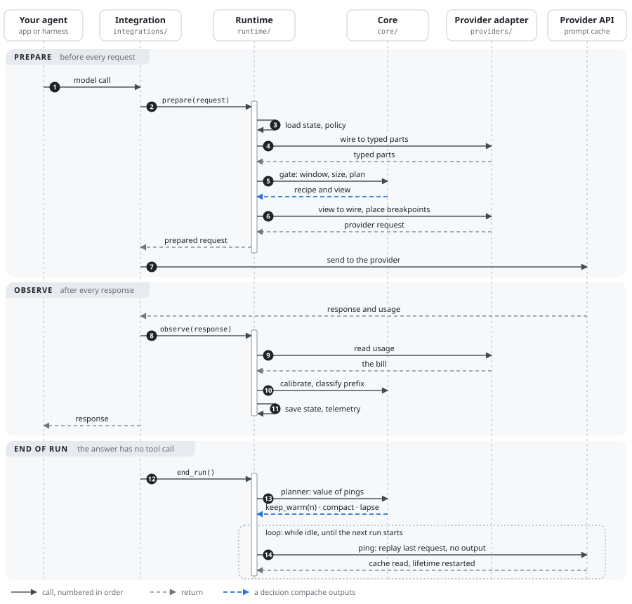

# Design: architecture and build plan

The [gate](compaction.md) and the [planner](retention.md) are specified. This doc covers what surrounds them: how their parameters are fitted from a user's own traces, what the package outputs, how it plugs into providers, frameworks and harnesses, and the order to build it in.

**Status:** agreed in outline. See [Decided](#decided). Every open choice is listed in the [README](../README.md#open-design-choices).

## Shape

```text
OFFLINE, on demand
  traces ─► connector ─► normalized threads ─┬─► cadence fitter ─────┐
                                             └─► dependency fitter ──┴─► profile
  profile + model spec ─► solver ─► policy

ONLINE, on every request: no model calls, no randomness
  request ─► integration ─► gate(policy, thread state) ─► provider
  run end ─► planner(policy, thread state) ─► keep_warm(n) | compact | lapse
```

A **thread** is one conversation: what a trace backend calls a session.

| Artifact | Describes | Comes from | Changes when |
|---|---|---|---|
| **Profile** | The workload: when threads come back, and what later turns reuse | The two fitters | Traces are refitted |
| **Model spec** | The provider: window, cache mode, lifetimes, price multiples, keep-warm mechanism | A table shipped with the package, overridable | The model or its prices change |
| **Policy** | Every knob the gate and planner read | `solve(profile, model spec, constraints)`, or the built-in defaults | Either input changes |

Each step is deterministic. The same traces give the same profile. The same profile and model spec give the same policy. The same policy, history and clock give the same bytes. A policy file records the hashes of its inputs, and a thread picks up a new policy only at its next cold start, since changing thresholds while warm could rewrite the prefix.

## The two fitters

Both read normalized threads and write one section of the profile. Neither runs online.

### Cadence fitter: the distribution between runs

Reads ids, timestamps and usage. It needs no content.

| Output | Definition | Read by |
|---|---|---|
| Return curve | Histogram of idle seconds from a run's end to the thread's next run, with a no-return mass, one row per run index | Planner |
| `last_call_seconds` | Typical time from the last request's start to the run's end | Planner |
| `later_calls` | Calls per later run, minus one | Planner |
| Growth | Calls per run, tokens added per call and per run by kind, runs per thread | Solver |

Every finished run is one observation: the gap to the next run, or a censored gap when the thread's last run had not been followed by export time. A survival estimate handles the censoring, and gaps past a horizon count as no return. A run-index row with too few observations falls back to the pooled row. Traces without thread ids give no cadence fit.

### Dependency fitter: what later runs use from earlier ones

For every turn it marks which earlier parts the turn used, split by kind:

| Kind | Parts |
|---|---|
| User input | Prompts, and tool results carrying the user's own words |
| Retrieved context | Tool results, documents and their passages |
| Final output | The answer that completes a turn |
| Working | Thinking, tool calls, intermediate narration |

Evidence of use, cheapest first:

1. **Structural, exact.** The answer cites a source from the part. A tool call carries an identifier the part introduced. `expand_compacted` names its handle. The same document is fetched again.
2. **Lexical, deterministic.** Distinctive spans of the part (numbers, identifiers, rare word sequences) appear in the turn's output or tool calls and nowhere in the turn's own new input.
3. **Judged, optional.** A model marks which earlier parts a sampled turn required. Labels are cached by content hash and used only to measure how much the first two signals miss.

| Output | Definition | Read by |
|---|---|---|
| Reuse by kind and distance | Share of a kind's tokens from turn `i` that turn `i + d` uses | Solver, report |
| Required set | The earlier parts each traced turn used | Solver, to price a miss |
| Detector recall | Share of judged requirements the signals found, when a judged sample exists | Solver, as a safety margin |

It needs message content, read locally. The profile holds only aggregates, so it is safe to commit. Threads whose traced requests were already compacted by the host are excluded: a part that was gone could not be used, so they would understate reuse.

## The solver

It automates the [evaluation method](integration.md#evaluation). Each traced thread is replayed through the real gate and planner against a simulated cache built from the model spec: lifetime from request start, refresh on read, minimum cacheable size, price multiples, and the thread's real gaps. Every request gets a ledger line of base, read, write and output tokens.

A **miss** is a turn whose required part the recipe had reduced. It is priced as one expansion round trip: an extra call that reads the prefix, then writes and carries the restored content.

- **Objective:** lowest expected cost per thread, misses included, with the share of turns that miss under a ceiling the user sets.
- **Search:** a fixed grid, keeping the relationships in [Reference](reference.md#defaults). Ties go to the larger target.
- **Honesty:** threads are split by a hash of their id. The policy is fitted on one part and its saving reported on the other.

| Knob | Evidence |
|---|---|
| Tier-1 grace turns | Reuse of retrieved context by distance |
| Cold trigger and target | Reuse of whole turns by distance, sizes, prices |
| Warm trigger, running-turn allowance, last-resort points | Growth per call inside a run |
| Cache lifetime option | Return curve against each option's write premium |
| Return curve, `last_call_seconds`, `later_calls` | Copied from the profile |

Margins, ping lead, the byte bound and ruler settings are engineering constants and are not fitted.

The report is a waterfall: what the traces cost, less prefix breaks fixed, less compaction, less keep-warm, with an oracle that knows every return time as the planner's upper bound.

## What the package outputs

| Question | Answered by | When | Output |
|---|---|---|---|
| How we compact | The gate's recipe | Each cold plan or warm replan | Which parts become placeholders or notes, and the view |
| When we compact | The gate's window and thresholds | Before every request | `applied_warm`, `replaced_warm`, `planned_cold` and the other [actions](compaction.md#keep-replace-or-plan) |
| When we ping | The planner | At run end | `keep_warm(n)` with due times, `compact`, or `lapse` |

Every integration maps onto four calls:

```text
prepare(thread, request, now) -> request    gate: view, breakpoints, layout
observe(thread, response, now)              the bill, cache evidence, calibration, run end
end_run(thread, now) -> decision            planner, where observe cannot infer the end
expand(thread, handle, offset) -> text      the recovery tool
```



Each decision is also returned as a record, so a host can execute it itself: schedule pings in its own queue, or apply the view in its own code.

**Defaults.** With no policy file, the gate runs on the [reference defaults](reference.md#defaults) and the model spec table. The planner needs a return curve and none ships, so without one it returns `lapse`. The runtime records its own gaps, so a first cadence fit needs no tracing backend. A model missing from the table is observed, never rewritten.

## Model spec

Cache behaviour, checked against provider documentation on 2026-11-14. Check again when building each adapter.

| Cache mode | Where | Gate | Keep-warm |
|---|---|---|---|
| Breakpoints with a write premium | Anthropic: 5 min at 1.25×, 1 h at 2×, reads 0.025–0.10×, minimum prefix 512–4,096 tokens by model. OpenAI GPT-5.6 and later: 30 min at 1.25×, 12 h at 2.5×, reads 0.05–0.10× | The full design | Anthropic: `max_tokens: 0`. OpenAI: `prewarm` on the Responses API, billing on an already cached prefix to verify |
| Automatic prefix, no write charge | OpenAI GPT-5.5 and earlier, retained in memory or 24 h. Gemini implicit caching, with no guarantee of a hit | Stability and cold/warm still apply, with `write = 1.0` | Usually none. Otherwise a minimum-output request |
| Stored cache billed per hour | Gemini explicit caches on Gemini 3 and 2.5 only: immutable, lifetime extended by an update call | The static prefix only | A storage term replaces the per-ping read. Later phase |

Three facts the other docs don't cover yet:

- A breakpoint looks back at most 20 positions on Anthropic, so a long turn needs an intermediate breakpoint.
- `max_tokens: 0` is rejected with streaming, structured outputs or a forced tool choice. A ping is sent non-streaming, and a run using structured outputs can't be pinged this way.
- Newer Claude models bind thinking blocks to unedited history. See [Risks](#risks).

## Traces

One normalized record per model call, as JSON lines. Content is optional.

```text
thread_id, run_id, call_index, started_at, ended_at, model,
usage { input, output, cache_read, cache_write },
request, response
```

| Source | Read path | Thread / run / call | Watch for |
|---|---|---|---|
| Langfuse | Observations API v2, or the blob export for bulk | `sessionId` / `traceId` / `generation` observation | The trace and session list APIs are gone in v4. Usage keys are free-form |
| MLflow | `mlflow.search_traces` with spans | `mlflow.trace.session` metadata / trace / `CHAT_MODEL` or `LLM` span | Previews are truncated, so read spans |
| OTel GenAI | OTLP JSON lines from the backend or a collector | `gen_ai.conversation.id` / `invoke_agent` span / inference span | Content is opt-in. Names vary by version, so alias tables per dialect, OpenInference and LangSmith included |
| SQL | A mapping file of queries onto the record | Defined by the user | A model can draft the mapping. A person reviews it |
| compache telemetry | Its own log | Native | Content-free, with exact cache outcomes and expansion calls |

Three caveats hold everywhere:

- Thread ids are optional in every backend. Without them there is no cadence fit.
- Span input and output are the provider's wire payload, so connectors reuse the provider adapters to parse them.
- Content may be masked or absent. The audit and the cadence fit still work; the dependency fit does not. Every fit reports its coverage.

## Integrations

Providers and harnesses already ship pieces of this: provider-side compaction, automatic breakpoints, a warming plugin. What they lack is a policy fitted to the workload and one rule across all of them. So an integration switches the overlapping piece off rather than stacking on it.

Each integration reaches one of three levels, and starts at the first:

1. **Audit.** Read requests and usage, change nothing, report prefix breaks and projected savings.
2. **Gate.** Rewrite the view and place breakpoints.
3. **Full.** Add the expansion tool and pings.

Hook names were checked against upstream source on 2026-11-14.

| Target | Mechanism | Thread id | Run end | Switch off |
|---|---|---|---|---|
| Anthropic, OpenAI, Gemini SDKs | A wrapper around the client's create call | Passed by the caller | A response with no tool call | Provider-side context editing or compaction |
| LangChain `create_agent` | `AgentMiddleware.wrap_model_call` with `request.override(messages=view)`, listed last. Its `tools` and `wrap_tool_call` carry the expansion tool | `runtime.execution_info.thread_id` | `after_agent` | `SummarizationMiddleware`, `ContextEditingMiddleware`, `AnthropicPromptCachingMiddleware` |
| LangGraph custom graphs | A chat-model wrapper, since the model call is user code | `config["configurable"]["thread_id"]` | A response with no tool call | Nothing built in |
| Hermes | A Python plugin providing a `ContextEngine`, which replaces the built-in compressor. `post_api_request` gives usage | `session_id`, `conversation_id` | `post_llm_call` | `compression.enabled`, `prompt_caching.cache_ttl` |
| opencode | A thin TypeScript plugin (`session.hook("context")`, `session.step.ended`, the idle hook) calling a local compache service | `sessionID` | The idle hook | `compaction.auto`, the `opencode.warming` plugin. Automatic breakpoints have no switch |
| Anything else | A local proxy speaking the provider's API, or a LiteLLM pre-call hook | A header, or a fingerprint of the first messages | Inferred | Level 2 at most: no expansion tool |

The package owns items 5 to 8 of the [harness contract](integration.md#harness-contract): the recipe store, the model table, the token counter and the ping sender. An integration supplies the rest.

Wrappers and proxies see only the wire format. They can't tell request-scoped context or dynamic instructions from history, so they treat the system prompt as static and the messages as history, and the audit reports what breaks the prefix instead of moving it.

One conformance suite runs against every integration with a fake provider: warm requests stay `extended`, the view matches expected bytes, expansion resolves, and pings stop when a run starts.

## Package layout

```text
src/compache/
  core/          parts, view identity, ruler, gate, planner      pure, no dependencies
  spec/          model spec table, profile and policy schemas, defaults
  providers/     anthropic, openai, gemini: wire to parts, breakpoints, usage, keep-warm
  runtime/       thread state store, ping scheduler, telemetry, the four calls
  integrations/  sdk wrappers, langchain, hermes, proxy and local service
  traces/        normalized record, connectors: jsonl, langfuse, mlflow, otel, sql
  fit/           cadence, dependency, detectors
  solve/         simulator, search, report
  cli.py         audit, fit, solve, serve
plugins/opencode/    TypeScript plugin that calls the local service
```

## Build plan

Two tracks that share the contracts of phase 0 and meet again at the simulator, which replays threads through the real gate. Phases 1 to 3 contain the [build order](integration.md#build-order) for the gate and planner.

| Phase | Runtime track | Offline track | Done when |
|---|---|---|---|
| **0 Contracts** | Typed parts, model spec table, policy schema with the reference defaults | Normalized record, profile schema, a deterministic generator of synthetic threads | Schemas round-trip and fixtures generate |
| **1 See** | Anthropic and OpenAI wire parsers, fingerprints, view identity, prefix transitions, an observe-only client wrapper | JSONL and Langfuse connectors, cost ledger, audit report | `compache audit` reports prefix breaks and cost on real traces, and a live continuity check agrees with the ledger |
| **2 Decide** | Gate planning as pure functions: window, sizing, tiers 1 and 2, projection. The planner rule | Cadence fitter, dependency fitter, simulator, solver, waterfall report | The planner matches the [test vectors](retention.md#test-vectors), the [invariants](reference.md#invariants) pass, and `compache solve` gives a policy with a held-out saving |
| **3 Act** | Recipe store, expansion tool, breakpoints, ping scheduler, warm replan, last resort, admission, LangChain middleware and LangGraph model wrapper | MLflow, OTel and SQL connectors, fitting from compache's own telemetry | A live thread stays `extended` on every warm request, and measured cost lands near the simulation |
| **4 Broaden** | Hermes plugin, opencode plugin and service, proxy, Gemini adapter, the stored-cache term | Judged calibration, counterfactual replay | Every integration passes the conformance suite |

Nothing touches live traffic before phase 3. Phase 1 already returns value on its own, because prefix breaks are the largest loss and the audit finds them from traces alone.

## Decided

- **The two optimizers are statistical fitters.** They are reproducible. A model serves only as an optional sampled judge and to draft SQL mappings, never online. Model-driven agents were rejected because two fits of the same traces would give different profiles.
- **No return curve ships, and keep-warm stays off without one.** The runtime records its own gaps so a fit can turn it on. A neutral curve was rejected because it spends on a guess.
- **Python 3.11 and up, with a dependency-free core.** compache is imported inside its hosts, which run older interpreters than the newest. Each integration and the fitting tools get their own extra.

## Risks

- **Dependency evidence is observational.** Reliance that leaves no trace in the output, such as a preference stated early, is invisible to the signals. Hence prompts stay verbatim, detector recall widens the margin, the expansion tool remains the safety net, and counterfactual replay comes in phase 4.
- **Preserved thinking.** A rewritten view can have later thinking blocks rejected or dropped on models that enforce it. This is already an open design issue and must be settled before the gate goes live on those models.
- **Simulated savings.** They are estimates until phase 3 compares them with a live bill.
- **Provider drift.** Cache modes changed on two providers this year. The model spec carries a checked-on date, and the live continuity check flags a spec that no longer matches the bill.
- **Two mechanisms at once.** A harness's own compaction, breakpoints or warming running beside compache rewrites the prefix. Each integration documents what to switch off, and the audit shows when it wasn't.
- **Thin traces.** Without thread ids or content, a fit covers less. The report says how much.
