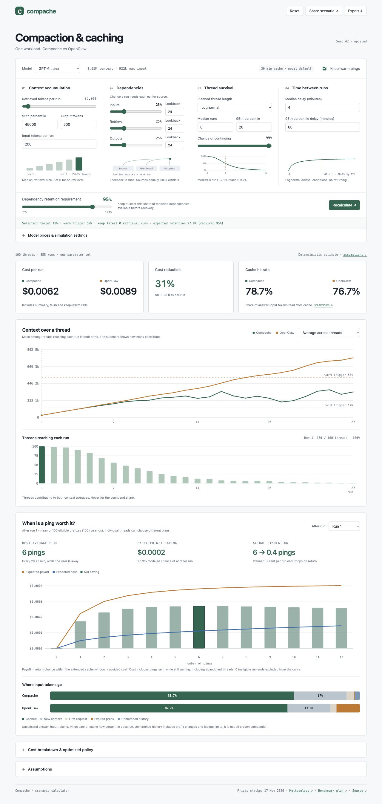

# compache

Context compaction and cache keep-warm policies fitted to your workload.

**[Open the interactive calculator ↗](https://barendpotijk.github.io/compache)** · [Methodology & sources](https://barendpotijk.github.io/compache/methodology.html)

Set the model, input/retrieval/output tokens, dependencies, thread length, return probability and time between runs. Choose a dependency retention requirement—95% by default—and compare Compache with OpenClaw's client-summary path.

*Preview of one synthetic scenario. Click the image to change the inputs; interactive controls run on the linked site.*

- **Cost per run:** answers, summaries, memory flushes and keep-warm pings.
- **Context:** averages across threads reaching each run, with a separate count chart and individual-thread selection.
- **Cache:** answer-input hit rate and expected ping payoff versus cost.

Deterministic scenario estimates; no model calls or API key required. Extra recovery calls are assumed zero, recalled input is charged, and dependency identification is assumed correct. Results do not establish answer quality or provider billing savings.

[Previous homepage README](../design/README.md) · [Implementation notes & earlier README](../design/implementation.md) · [Architecture & build plan](../design.md) · [Implementation PR](https://github.com/BarendPotijk/compache/pull/2)
