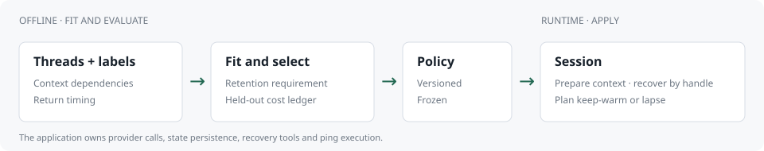

# How it works

compache answers three questions from your recorded threads: what must stay in the request, when a keep-warm ping pays and how long the cache should live. It answers them together, because each changes what the others are worth. A cut rewrites the cached prefix, a ping costs in proportion to the prefix it keeps warm, and a longer lifetime saves pings but makes every write dearer.

## What is read from the threads

| From | The fit learns |
|---|---|
| Timestamps | For each turn position: whether the user came back, after how long, and how long the answer took. A second turn and a twentieth are measured apart, so a thread that has come far can be more likely to go on, and sooner. A wait that the record cuts short is treated as unfinished, not as a user who left |
| Text sizes | How much each turn adds: its question, its retrieved text, its answer |
| Calls | How many model calls a turn made, when the record says. A call after the first reads the turn's request from the cache |
| Usage | Where the provider's usage is recorded: how much of a request still in the cache the next turn actually read. A record that shows no cache reads or writes at all says nothing, and the provider's rules are assumed |
| Labels | For each kind of part, how far back the evidence a turn needed lies |

## The candidates

A cut is three windows: how many turns of questions, of answers and of retrieved text stay in view. Three refinements: earlier retrieved text that matches the new question may stay, parts under a size may always stay, and where answers record the sources they cited, cited sources may stay for a number of turns of their own.

- Windows follow 1, 2, 5, 10 and so on, plus the look-backs that cover 80% to 100% of the labelled needs of each kind.
- Every cut is scored without a replay: an applied cut archives a part once it leaves its window, so how much of what turns needed is still in view follows from how far back that evidence lies.
- Where every turn is labelled and none needs an earlier turn, a cut is admitted on that evidence. One turn whose need is unknown rules it out.
- The cuts worth pricing are those on the frontier: each keeps at least one point more in view than every smaller one, down to 80%. Up to six of them, plus keeping everything, are each paired with 0, 1 and 3 pings, and with each cache lifetime the model can be asked for. Claude keeps an entry for five minutes, or for an hour at 2× the input price for a write instead of 1.25×.

## The price of a candidate

Token counts cannot rank policies, because what a cut or a ping is worth depends on how often the cache is still warm when the user returns.

- Each candidate runs through the runtime session against the provider's cache rules: lifetime, smallest cacheable prefix, write and read prices and any long-request surcharge. Requests and pings fall at the threads' own timestamps.
- A thread is priced with a model of returns fitted on the other threads, in three folds. The same threads say how much of a live cache entry is read: the cached tokens of each return inside the lifetime, as a share of the request before it. Every request and ping of every candidate is priced at that share.
- A cut pays for what it loses. Every labelled need that is missing from the request as sent costs one more request, which reads the cached view, writes the reopened parts and emits a tool call. That rate carries from the labelled turns to all turns.
- The cheapest candidate wins. Ties go to more in view, then to the shorter lifetime, then to fewer pings.

The winner is the cheapest policy the fit priced on your threads. Keeping everything, with and without pings and under each lifetime, is always among those, so the fit also says what caching alone would cost at its best. `compache replay` prices it on threads it has not seen.

## At runtime

| Moment | Decision |
|---|---|
| A new user message | Send the history as it is, or apply the cut. The session compares expected cost over the fitted returns, three turns ahead. A cut usually waits for a return that finds the cache cold, when rewriting the prefix costs nothing extra |
| An answer is recorded | Let the cache lapse, or schedule up to the fitted number of pings before its lifetime ends. Pings are charged for users who never return. A returning user cancels the timer |
| A ping comes back | Its usage shows whether the cache was read. If so, the next ping is priced again. If not, pinging stops for that wait |
| The model asks for an archived part | The reopen tool returns the original text from the session's history |

A request that should have hit the cache and read nothing suspends pings for that conversation and records which part of the prefix changed.

## In the request path

`compache.wrap` and `compache proxy` run that session on the JSON of every model call. Your application keeps sending its whole history.

| Step | What happens |
|---|---|
| Read the request | A user message opens a turn. Tool results are its retrieved text, assistant text its answer. The text blocks of one tool result are one part, as in a recorded thread |
| Find the conversation | By its name, or by what it has said so far |
| Decide | A new user message: the session decides as above. Another call of the same turn, as in a tool loop: the decision stands, and what the tools returned joins the turn |
| Rewrite a copy | Archived parts get their notice, and from the first notice on the model has a `reopen` tool. A notice says that its part was read in full: where a model only finds a reference, it takes what it wrote from the part for made up. A part no larger than its notice stays. Tool calls, images, thinking blocks and anything unknown stay as they were |
| Read the reply | The model's `reopen` calls are answered and the model asked again, inside a stream too. A model still fetching after three rounds, or saying nothing, gets the application's own request instead, and a conversation where that happens twice is left alone. Of a turn with several calls, the first call's usage says what the turn found cached and the last call's what it leaves |

## Agents

A turn of an agent is a loop of many calls, so there the unit is the call. `compache fit` sees it by the calls per turn and fits a policy of its own, `compache.agent`.

| | |
|---|---|
| What is decided | The newest rounds of tool results stay in full. Older ones become a notice, and the reasoning of finished turns goes with them, at the next call where that is cheaper at once (the cache has expired, or a long request is billed dearer), or where what goes is so many times as large as what would be written again behind it |
| What is fitted | How many rounds, how many times, keep-warm pings while a tool runs and while a user is away, the cache lifetime, and whether instructions and tools get a longer one. Some 250 candidates, each priced on every recorded call by the provider's cache rules |
| What has to stay | At least 85% of the calls that rely on an earlier result find it in view, or no more than 1% of all calls miss one. A call relies on a result where its reply repeats a line that only this tool returned. A call that does not find it is priced as fetching it back: one more call, and the result again |
| Reasoning | Claude takes its reasoning back only behind what stood ahead of it when it was made. Where that has changed, the provider drops it or refuses the request. So a cut takes out all reasoning behind it, and what is reasoned after it stays. OpenAI from GPT-6.2 on drops the reasoning behind an item that was changed, and keeps it behind items taken out whole: there a cleared result leaves with its call, and a list at the end of the request names it. With other models the reasoning of the turn that goes on stays, whatever is cut |
| Sizes | The provider's own count. What a request grew by belongs to the results that joined it, so text that is dense in tokens counts as dense. A result with a picture goes as a whole, and comes back with it |
| Shared instructions | A conversation that begins while another has the same instructions and tools in the cache reads them |
| Too little data | Under 200 calls, only the cut that public runs taught is priced, with every lifetime and number of pings |

`Flow`, what a conversation holds and what the provider has cached of it, is one class that the fit, the replay and the runtime share, so what was priced is what happens.

In the request path a loop is recognized by the IDs of its tool calls, where these are found once, and by what was said. Conversations that share a name, as a main agent, those it starts and several that go on from one, are kept apart by what they were asked and what their tools returned, and a request that branches off, as a host's suggestion of what to say next, leaves the main line as it stood. What the model fetched back is put into the later requests at its place, and goes with the cut it would go with. Where an application rewrites what its tools had returned, the policy starts over from what it says now. A model that is switched away from and back goes on where it left off. Where one fetches the same back again, results stay for twice as long, while there is room.

## Notes from the model

Labels normally come from reading past conversations. Where those cannot be read, the model that answered is asked, on a sample of turns.

- **What is asked.** Once the reply is in, one short request continues the conversation: the reply, a list of the conversation's parts with a label and the first words of each, and the request to name the parts the reply needed. A part is needed if a fact came from it, or if the user's message only makes sense with it. The application's own request and reply are not touched.
- **What comes back.** One line of labels, such as `R3.1` for the first text retrieved in turn 3 or `A2` for the answer of turn 2. No text.
- **What they become.** For that turn, a label that it needed those earlier parts. A part the model fetched back while answering counts too.
- **What it costs.** Everything before the reply is read from the cache. On Claude Haiku 5.5 a note cost about half of what a turn does, most of it the model thinking before it writes the line.

A model names what helped as readily as what the turn could not do without, so notes are looser than a measurement. [The live runs](../benchmarks/live/README.md#the-models-notes) compare both on the same conversations, and the policies fitted on each.

## Assumptions

- One model call per user message, unless the threads record more. An agent's policy takes the calls one by one.
- The cache lifetime counts from when a request is sent, so a long answer leaves less of it for the user's return.
- A cache entry lives exactly the lifetime in the model spec.
- Tokens are estimated at four bytes each unless the engine is given a tokenizer.
- A need counts as in view only when a whole alternative is in the request before anything is fetched back.
- Labels are judgements about need. [DocChat](../benchmarks/docchat/README.md) measures them instead, by answering each turn again with parts withheld.
